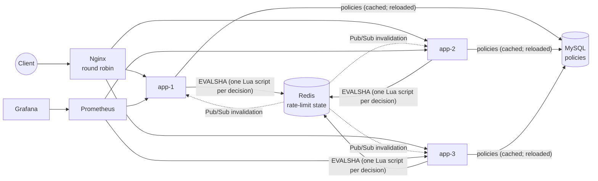
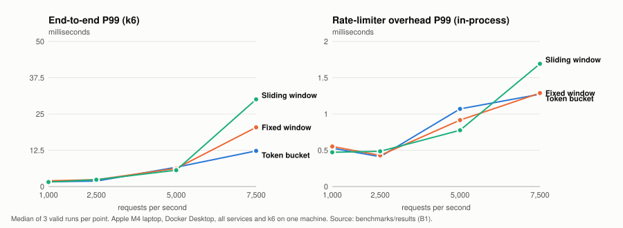
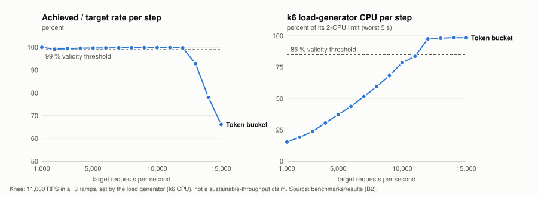
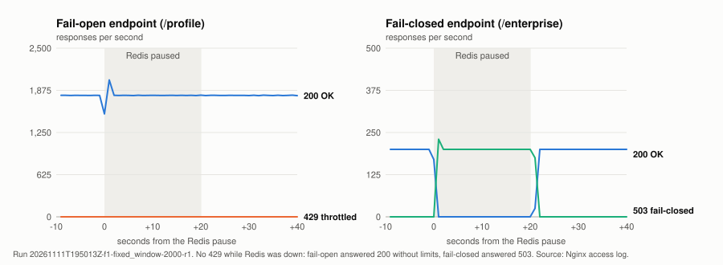

# Distributed Rate Limiter

A rate limiter for horizontally scaled Spring Boot services. Every instance enforces **one shared quota per client**,
stored in Redis and updated **atomically with Lua scripts**, so a client spreading requests across instances never
gets more than its limit. Policies are managed at runtime and stored in MySQL. The project includes the full path to
production-style operation: a three-instance deployment behind Nginx, metrics and dashboards, failure handling with a
circuit breaker, and a reproducible benchmark campaign with honest, machine-specific results.

**Java 17 · Spring Boot 3.5 · Redis 7.4 (Lua) · MySQL 8.4 · Spring Security (JWT) · Resilience4j · Micrometer ·
Prometheus · Grafana · Nginx · Docker Compose · k6 · Testcontainers**

## Highlights

- **Atomic distributed enforcement:** each decision is one Lua script on Redis (read, decide and write in one step,
  using Redis `TIME` as the single clock). No GET-then-SET from Java; no per-instance counters.
- **Three algorithms behind one strategy interface:** Token Bucket, Fixed Window Counter, Sliding Window Counter,
  selectable per policy, with exact integer arithmetic and keys that expire as soon as they are equivalent to fresh.
- **Runtime policy management:** a REST API (admin only) with validation and optimistic locking; every instance keeps
  an in-memory snapshot, invalidated through Redis Pub/Sub with a periodic reload as a safety net. MySQL is never on
  the per-request path.
- **Identity and HTTP contract:** JWT (HS256) users keyed by id, anonymous callers by client IP (trusted-proxy aware),
  `X-RateLimit-*` headers, `429` with `Retry-After` and an RFC 7807 body.
- **Failure handling:** per-policy fail-open or fail-closed (`503`, never `429`), a Redis circuit breaker per instance,
  readiness that does not drop traffic when a dependency fails.
- **Observability:** Micrometer metrics with bounded labels, Prometheus, a provisioned Grafana dashboard, and
  per-policy statistics shards (`/api/v1/policies/{id}/stats`) flushed exactly once.
- **Evidence over claims:** 318 automated tests (unit, Lua-against-real-Redis, differential, multi-instance), a 37-check
  stack smoke test, and 212 benchmark runs with automatic validity rules and exact count reconciliation.

## Architecture



Request path inside an instance: Tomcat (trusted-proxy client IP) → Spring Security (JWT) → `RateLimitFilter`
(identity → most specific policy → algorithm → circuit-breaking Redis executor) → `X-RateLimit-*` headers and
`429`/`503`, or the controller. Details: [docs/03](docs/03-system-architecture.md), [docs/07](docs/07-api-documentation.md).

## Measured results

> **Environment and honesty first.** Everything below was measured on **one Apple M4 laptop running Docker
> Desktop**, with the three instances (1.5 CPU each), Redis, MySQL, Nginx, Prometheus, Grafana *and the k6 load
> generator* on the same machine. The numbers show relative behaviour and this machine's limits; they are **not
> production capacity**.

**212 benchmark runs: 153 valid, 59 invalid.** A run is invalid if, for example, the load generator dropped a single
scheduled request, fell below 99 % of the target rate, or the request counts did not reconcile exactly across k6,
Nginx, the instances, Prometheus and `/stats`. Invalid runs are kept with their reasons and are never used in results.

| Result | Value |
|---|---|
| Highest validated load level and maximum sustainable throughput | **7,500 RPS** for all three algorithms (3 valid runs each; end-to-end P99 ≤ 30.1 ms, 0 non-429 errors) |
| 10,000 RPS | Attempted for every algorithm; **not achieved** (all attempts invalid: load generator and instances at their limits) |
| Stress-ramp knee | 11,000 RPS in 30-second steps, **set by the load generator's CPU**; not a sustainable-throughput claim |
| Rate-limiter overhead (in-process) at 5,000 RPS | P99 0.78–1.07 ms (target < 20 ms) |
| End-to-end latency added by the limiter (5,000 RPS) | +0.13 ms at P50, +2.3 ms at P99 (A/B with the limiter disabled) |
| Correctness under load | **Zero over-admission** in every run; exactly 100 of 1,000 simultaneous requests admitted across 3 instances |
| Redis memory per active client key | 104–112 bytes |





Full tables (every algorithm, load level, latency view and resource), method and the list of invalid runs:
[docs/11-performance-benchmarks.md](docs/11-performance-benchmarks.md). Analysis and acceptance checklist:
[benchmarks/reports/phase-3b-final/analysis.md](benchmarks/reports/phase-3b-final/analysis.md).

## Failure behaviour under load (2,000 RPS)

| Fault | What clients saw |
|---|---|
| Redis paused 20 s | Fail-open endpoint: 200 without limits; fail-closed endpoint: 503; **no 429 during the outage**. Breakers opened within 1–5 s and closed 4–6 s after Redis returned |
| Redis restarted | Brief 503s on the fail-closed endpoint; recovered in 9–11 s; quotas reset (no persistence, by design) |
| One instance killed for 30 s | No client-visible errors while it was down (Nginx failover); brief 503s on the fail-closed endpoint as it rejoined cold |
| MySQL stopped 60 s | No effect on rate limiting (cached policies); policy API 503 |
| Redis slowed (142 ms / 388 ms blocks) | 142 ms absorbed; 388 ms opened the breakers until the blocks ended |



Timelines and evidence: [docs/13-failure-handling.md](docs/13-failure-handling.md).

## Known limitations

- **Cold-start fail-open:** shortly after an instance restarts, a burst of 1,000 simultaneous requests can push Redis
  calls past the 250 ms timeout (CPU-quota throttling while the JVM compiles hot code), so some requests fail open.
  Warm instances are exact. Investigated and documented; not yet fixed ([docs/13](docs/13-failure-handling.md)).
- The Sliding Window Counter is an approximation (bounded, documented in [docs/05](docs/05-rate-limiting-algorithms.md)).
- One Redis primary: a Redis restart resets quotas; failover with asynchronous replication could briefly over-admit.
- Requests with invalid tokens are rejected before the limiter (not rate limited); no TLS in the local deployment
  (the API is published on `localhost` only).
  See the security review: [docs/16](docs/16-security-review.md).
- Benchmarks ran on one laptop; the load generator, not the rate limiter, set the upper bound of what could be
  measured.

## Run it

Requirements: Docker (Compose v2), Java 17, Python 3 (for the helper scripts).

```bash
cp .env.example .env            # set every change-me value (MySQL, JWT_SECRET, Grafana password)
```

```bash
scripts/stack-up.sh             # Nginx + 3 instances + Redis + MySQL + Prometheus + Grafana, health-checked
```

```bash
scripts/stack-smoke.sh          # 37 checks: health, distribution, exact quota under 1,000 concurrent requests, monitoring, reconciliation
```

```bash
./mvnw clean verify             # 318 tests (integration tests use Testcontainers)
```

API: `http://localhost:8080`, Grafana: `http://localhost:3000`, Prometheus: `http://localhost:9090`. Development
profile, policy API walkthrough and the benchmark tooling: [docs/14-deployment-guide.md](docs/14-deployment-guide.md).

## Design decisions (selected)

| Decision | Why | Trade-off |
|---|---|---|
| One Lua script per decision, Redis `TIME` as the clock | Atomic across any number of instances; no clock skew | Every decision is a Redis round trip |
| Sliding Window **Counter**, not Log | O(1) memory per client | Approximate at window boundaries |
| Fail-open by default, fail-closed per policy | Availability first; strictness where it matters | Fail-open admits without limits during an outage |
| Circuit breaker at the Redis executor | An outage costs ~10 timed-out requests per instance, then microseconds | Limits resume only after a 5 s wait and 3 successful probes |
| Policy snapshot in memory, Pub/Sub + periodic reload | MySQL never on the hot path | Up to 30 s staleness if a message is lost |
| Statistics as per-instance shards, exactly-once batches | No hot counter key | `/stats` lags by up to 5 s |

All 51 decisions with evidence: [docs/04-design-decisions.md](docs/04-design-decisions.md).

## Documentation

| | |
|---|---|
| [00 Architecture proposal](docs/00-architecture-proposal.md) | [09 Concurrency & correctness](docs/09-concurrency-and-distributed-correctness.md) |
| [01 Overview](docs/01-project-overview.md) | [10 Testing strategy](docs/10-testing-strategy.md) |
| [02 Requirements](docs/02-requirements.md) | [11 Benchmarks](docs/11-performance-benchmarks.md) |
| [03 Architecture](docs/03-system-architecture.md) | [12 Observability](docs/12-monitoring-and-observability.md) |
| [04 Design decisions](docs/04-design-decisions.md) | [13 Failure handling](docs/13-failure-handling.md) |
| [05 Algorithms](docs/05-rate-limiting-algorithms.md) | [14 Deployment guide](docs/14-deployment-guide.md) |
| [06 Redis data design](docs/06-redis-data-design.md) | [15 Interview preparation](docs/15-interview-preparation.md) |
| [07 API](docs/07-api-documentation.md) ([OpenAPI](docs/api/openapi.json)) | [16 Security review](docs/16-security-review.md) |
| [08 Database schema](docs/08-database-schema.md) | [Benchmark evidence](benchmarks/README.md) |

Project status and history: [PROJECT_PROGRESS.md](PROJECT_PROGRESS.md).
