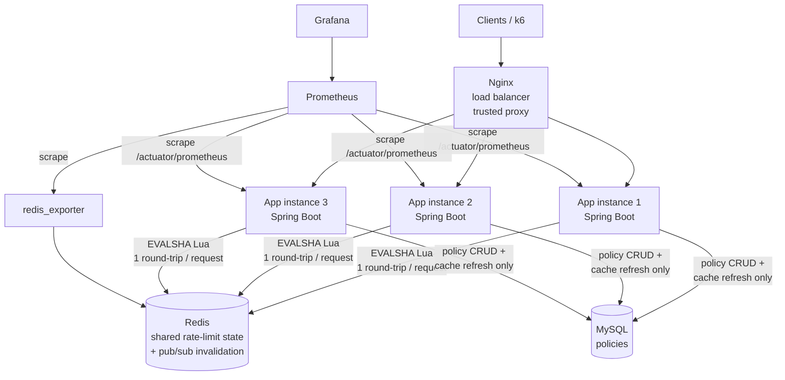
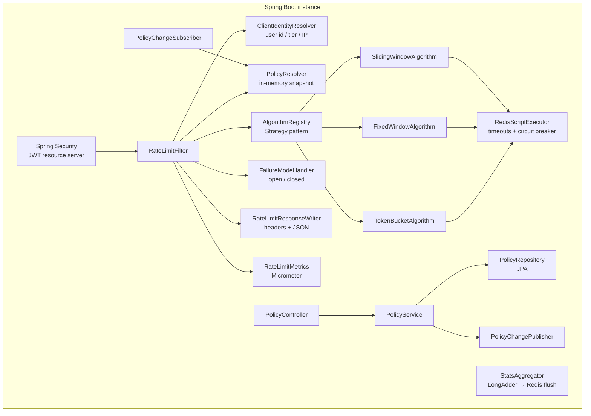
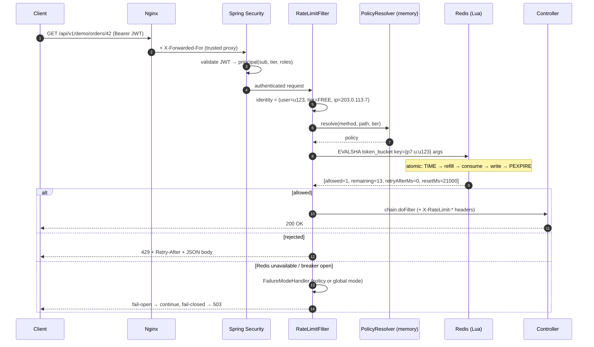
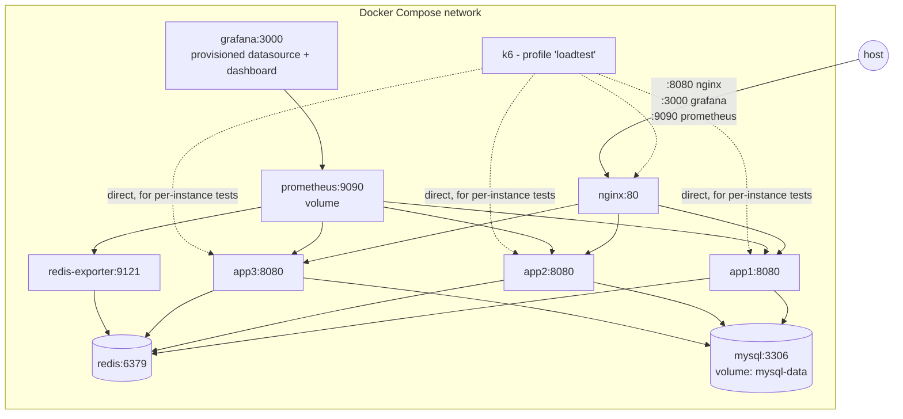

# Distributed Rate Limiter — Architecture Proposal (Phase 0)

> Status: **approved at the end of Phase 0; kept as the historical design record.** The text below is unchanged from the approved proposal, which used an eight-phase plan; the project was later consolidated into four phases (Phase 3 = 3A + 3B). The implemented system is described in docs 01–14, decisions in docs 04 (D1–D50).
> Once approved, this document gets split into `docs/01..15-*.md` and kept current as the build proceeds.

---

## 0. Environment check (done before designing)

| Item | Found | Impact |
|---|---|---|
| CPU / RAM | Apple M4, 10 cores, 16 GB | Enough for the full stack; **not** enough to isolate load generator from system under test |
| OS | macOS 27.2 | Docker runs in a Linux VM; host→container port forwarding adds latency |
| Java | OpenJDK 17.0.18 | Matches requirement (no virtual threads — those need Java 21) |
| Maven | 3.9.11 | OK |
| Docker / Compose | 28.5.1 / v2.40.3 | OK for Testcontainers and Compose |
| k6 | **not installed** | Will run k6 from the `grafana/k6` Docker image (inside the Compose network), or `brew install k6` |

---

## 1. Requirements analysis — problems found in the brief

These are the places where the brief, taken literally, would produce a weaker or misleading system. Each has a proposed resolution.

| # | Problem | Why it matters | Proposed resolution |
|---|---|---|---|
| P1 | **Benchmarking on one laptop.** 3 JVMs + Nginx + Redis + MySQL + Prometheus + Grafana + k6 all share 10 cores. | At 5–10k RPS the load generator steals CPU from the system under test. Numbers will reflect the laptop, not the design. | Measure two things separately: (a) **rate-limiter overhead** via an in-process Micrometer timer around the check (independent of load-gen noise), (b) **end-to-end** latency from k6. Report both, with the environment. Never present laptop numbers as production capacity. |
| P2 | **Using the app clock.** Three instances have three clocks. | Clock skew between instances corrupts window boundaries and refill math. | All time comes from **Redis `TIME` inside the Lua script** — one clock for the whole cluster. (Testability trade-off handled in §10.4.) |
| P3 | **Policy dimensions overlap.** IP, user, endpoint, tier can all match one request. | Without explicit precedence, behaviour is undefined and untestable. | Deterministic **most-specific-match** resolution (§7.3). MVP evaluates one policy per request; stacked policies are an advanced feature. |
| P4 | **Raw URI as key.** `/orders/1`, `/orders/2`, … | Unbounded Redis keys and metric labels; trivially bypassed. | Keys use the **policy id** (which encodes the matched route pattern), never the raw path. |
| P5 | **Policy change vs. existing state.** Changing an algorithm leaves a Redis value of the wrong type. | `WRONGTYPE` errors, or a token-bucket hash read as a counter. | Algorithm code is part of the key: an algorithm switch starts fresh state; a limit change keeps state (token bucket clamps to new capacity). |
| P6 | **`/policies/{id}/stats` written per request.** Incrementing a per-policy stats key inside the Lua script. | Every request for the FREE tier hits one key → a manufactured **hot key**, and a cross-slot write in Redis Cluster. | Each instance aggregates in memory (`LongAdder`), flushes to Redis every 5 s. Stats are eventually consistent (documented). |
| P7 | **"Configurable Redis connection pooling."** | Lettuce uses one thread-safe, multiplexed connection; pooling usually *adds* latency for single-command workloads like this. | Make it configurable as asked, default **off**, and **benchmark both** — a measured answer is a better interview story than a default. |
| P8 | **Fail-closed returns 429.** | 429 tells the client *they* exceeded a quota; that is false when Redis is down. | Fail-closed returns **503 Service Unavailable** + `Retry-After`. 429 is reserved for real quota exhaustion. |
| P9 | **Redis outage + timeout = every request waits.** | With a 100 ms timeout and Redis down, every request pays 100 ms before failing open/closed. | **Circuit breaker** (Resilience4j) around Redis: after N failures, skip Redis instantly until a half-open probe succeeds. |
| P10 | **Blindly trusting `X-Forwarded-For`.** | Any client can set the header and rotate "IPs" to evade IP limits. | Use Tomcat's `RemoteIpValve` (`server.forward-headers-strategy=native`) with an explicit **trusted-proxy CIDR** (Nginx only). Rightmost-untrusted-hop semantics. No hand-written header parsing. |
| P11 | **Spring Boot 3.x lifecycle.** Spring Boot 4 is GA; 3.5.x is the final 3.x line and its OSS support window may have ended by now. | A reviewer may ask why not 4.x. | Keep **3.5.x** (as required; most hiring codebases are still on 3.x). Pin the latest 3.5.x patch at Phase 1 and document the 4.x migration path. |
| P12 | **Throughput tests with a closed model.** | Fixed-VU loops slow down when the server slows down → *coordinated omission* hides tail latency. | Use k6 **`constant-arrival-rate`** (open model) for RPS targets; closed model only for the "1,000 simultaneous requests" test. |

---

## 2. Proposed system architecture

### 2.1 High-level



**Hot path** (every request): Nginx → app → in-memory policy match → **one Redis round-trip** → controller or 429.
**Cold path** (rare): policy CRUD → MySQL → publish invalidation → all instances reload.

MySQL is **never** on the hot path.

### 2.2 Component view (inside one instance)



| Component | Responsibility |
|---|---|
| `RateLimitFilter` | Orchestrates the check; the only place rate limiting is wired in. Controllers stay unaware. |
| `ClientIdentityResolver` | Produces `(userId?, tier, clientIp)` from the authenticated principal and the proxy-validated remote address. |
| `PolicyResolver` | Holds an immutable, pre-compiled snapshot of all enabled policies; picks the most specific match in O(P) memory ops. |
| `RateLimitAlgorithm` (×3) | Strategy implementations; each builds its key and arguments and interprets the Lua result. |
| `RedisScriptExecutor` | Runs scripts via `EVALSHA` (Spring falls back to `EVAL` on `NOSCRIPT`), times them, applies the circuit breaker. |
| `FailureModeHandler` | Decides allow/deny when Redis is unavailable, per policy or global default. |
| `RateLimitResponseWriter` | Sets `X-RateLimit-*`, writes the 429/503 JSON body. |
| `PolicyService` / `PolicyController` | CRUD, validation, optimistic locking, publishes change events. |
| `PolicyChangeSubscriber` | Redis pub/sub listener → reloads snapshot. Plus a periodic full reload as a safety net. |
| `StatsAggregator` | Per-policy allowed/rejected counters, flushed to Redis every 5 s for `/stats`. |

### 2.3 Request lifecycle



**Filter placement:** inside the Spring Security chain, **after** `BearerTokenAuthenticationFilter`, so the principal (and tier) is known. Anonymous requests continue with tier `ANONYMOUS` and are keyed by IP.

> Known gap (documented, advanced fix): requests with an *invalid* token are rejected with 401 before the limiter runs. JWT validation is cheap (HMAC), so this is acceptable for MVP; the advanced version adds a coarse IP pre-auth limit.

### 2.4 Multi-instance and deployment



Instances are **stateless** with respect to quotas: any instance can die or be added with no rebalancing. Only the in-memory policy snapshot is per-instance, and it is a cache.

---

## 3. Rate-limiting algorithms — comparison

All three share one interface (Strategy pattern):

```java
public interface RateLimitAlgorithm {
    AlgorithmType type();
    RateLimitDecision evaluate(RateLimitKey key, ResolvedPolicy policy);
}
// RateLimitDecision(boolean allowed, long limit, long remaining, long retryAfterMs, long resetAfterMs)
```

| | Token Bucket | Fixed Window Counter | Sliding Window **Counter** (chosen) |
|---|---|---|---|
| Model | Bucket of `capacity` tokens, refills `refillTokens` per `periodMs` continuously | Count per aligned window `floor(now / W)` | Weighted: `prev × (1 − elapsed/W) + curr` |
| Bursts | Allows bursts up to capacity (by design) | Up to **2× limit** across a boundary | Smoothed; bounded overshoot |
| Accuracy | Exact for its model | Exact per window, wrong at boundaries | Approximate (assumes uniform prev-window traffic) |
| Redis type | Hash `{tk, ts}` | String counter | Hash `{ws, c, p}` |
| Memory / key | O(1) ~ tens of bytes | O(1) | O(1) |
| Time / request | O(1) | O(1) | O(1) |
| Keys per check | 1 | 1 | 1 (cluster-safe) |
| Retry-After | `ceil((1 − tokens) / rate)` | time to window end | solve weighted count < limit for t |
| Best for | Public APIs that tolerate short bursts | Simple quotas, billing-style counts | Smooth per-user API limits |

### 3.1 Why Sliding Window *Counter*, not *Log*

| | Sliding Log (ZSET) | Sliding Counter (Hash) |
|---|---|---|
| Accuracy | Exact | ~Approximate |
| Memory per client | O(limit) — ENTERPRISE 1,000/min ⇒ up to 1,000 members (~tens of KB) | O(1) |
| Cost per request | `ZREMRANGEBYSCORE` + `ZCARD` + `ZADD`: O(log N + M) | O(1) |
| Gotchas | Same-millisecond requests need unique members | Approximation must be explained |

At 100k ENTERPRISE clients, the log costs gigabytes; the counter costs a few MB. I propose implementing the **counter** and documenting the log (with its memory math) as the exact-but-expensive alternative. If you want both, the log can be a fourth strategy in the advanced phase — the interface already supports it.

### 3.2 Fixed window boundary burst (to be demonstrated, not just described)

Limit 100/min. 100 requests at 00:59.9, 100 at 01:00.1 → **200 accepted in 0.2 s**. A dedicated test will reproduce this deterministically (see §10.4) and the same traffic replayed against the sliding counter and token bucket will show the difference.

---

## 4. Redis data model

### 4.1 Keys

```
rl:{<policyId>:<subjectType>:<subjectId>}:<alg>[:<windowIndex>]
```

| Algorithm | Key example | Type | Fields / value | TTL |
|---|---|---|---|---|
| Token bucket | `rl:{7:u:u123}:tb` | Hash | `tk` tokens (float), `ts` last refill ms | time-to-full + 1 s |
| Fixed window | `rl:{7:ip:203.0.113.7}:fw:29483021` | String | count | window + 1 s |
| Sliding counter | `rl:{7:u:u123}:sw` | Hash | `ws` window start ms, `c` current, `p` previous | 2 × window |
| Stats | `rl:stats:{7}` | Hash | `allowed`, `rejected` | none (small, bounded by policy count) |
| Invalidation | `rl:policy-events` | Pub/Sub channel | `{policyId, version, op}` | — |

- **`{…}` hash tag** keeps every key for one (policy, subject) in one Redis Cluster slot, so scripts never become cross-slot when we move to Cluster.
- **Subject id** is capped in length; user ids come from a signed JWT, IPs are normalized (IPv6 compressed). No raw URLs in keys.
- **Every key has a TTL**, so idle clients cost nothing and `maxmemory-policy volatile-ttl` is a safe eviction policy.

### 4.2 Lua scripts — the atomicity contract

Each algorithm is **one script = one round trip = one atomic unit**. Redis executes a script to completion without interleaving other commands, so read-modify-write cannot race.

Token bucket, in outline (the real script lands in Phase 2):

```
now      = redis TIME (ms)               -- single clock for all instances
tk, ts   = HMGET key tk ts  (default: capacity, now)
tk       = min(capacity, tk + (now - ts) * rate)
if tk >= 1: tk -= 1; allowed = 1 else allowed = 0
retryMs  = allowed ? 0 : ceil((1 - tk) / rate)
HSET key tk ts=now ; PEXPIRE key ceil((capacity - tk) / rate) + 1000
return {allowed, floor(tk), retryMs, resetMs}
```

Rules: no `GET`-then-`SET` from Java; scripts loaded once and called via `EVALSHA`; scripts touch only the key passed in `KEYS` (cluster-correct); integer return values only (Lua→RESP truncates floats).

### 4.3 Redis server configuration

| Setting | Value | Reason |
|---|---|---|
| Image | `redis:7.4-alpine` | Scripts use `TIME` with effects replication (default since 7) |
| Persistence | RDB off, AOF off | State is ephemeral; persistence adds fsync latency for no correctness gain (a restart = everyone's quota resets, documented) |
| `maxmemory` / policy | e.g. 256 MB / `volatile-ttl` | Never evict non-TTL keys; evict soonest-expiring first |

---

## 5. MySQL schema

One core table. Flyway migrations; JPA with `@Version` for optimistic locking.

```sql
CREATE TABLE rate_limit_policy (
  id               BIGINT       PRIMARY KEY AUTO_INCREMENT,
  name             VARCHAR(100) NOT NULL UNIQUE,
  description      VARCHAR(500),
  http_method      VARCHAR(10)  NULL,            -- NULL = any method
  endpoint_pattern VARCHAR(255) NOT NULL,        -- Spring PathPattern, e.g. /api/v1/orders/**
  tier             VARCHAR(20)  NULL,            -- ANONYMOUS|FREE|PREMIUM|ENTERPRISE, NULL = any
  key_by           VARCHAR(10)  NOT NULL,        -- IP | USER  (USER falls back to IP if anonymous)
  algorithm        VARCHAR(20)  NOT NULL,        -- TOKEN_BUCKET|FIXED_WINDOW|SLIDING_WINDOW
  limit_value      INT          NOT NULL,        -- capacity / max requests per window
  window_ms        BIGINT       NOT NULL,        -- window, or token-bucket refill period
  refill_tokens    INT          NULL,            -- token bucket only; default = limit_value
  failure_mode     VARCHAR(12)  NULL,            -- FAIL_OPEN|FAIL_CLOSED, NULL = global default
  priority         INT          NOT NULL DEFAULT 0,  -- final tie-break only
  enabled          BOOLEAN      NOT NULL DEFAULT TRUE,
  version          INT          NOT NULL DEFAULT 0,
  created_at       TIMESTAMP(3) NOT NULL DEFAULT CURRENT_TIMESTAMP(3),
  updated_at       TIMESTAMP(3) NOT NULL DEFAULT CURRENT_TIMESTAMP(3) ON UPDATE CURRENT_TIMESTAMP(3),
  CONSTRAINT chk_limit  CHECK (limit_value > 0),
  CONSTRAINT chk_window CHECK (window_ms >= 100)
);
```

Seed data (Flyway `V2__seed.sql`): `ANONYMOUS` 10/min by IP, `FREE` 20/min, `PREMIUM` 100/min, `ENTERPRISE` 1,000/min by user.

**Why no `users` table?** Identity and tier come from a signed JWT. This keeps MySQL off the hot path entirely. A `demo` profile exposes a token-minting endpoint for testing; it is disabled in any other profile. (Advanced: a `policy_audit` table.)

---

## 6. REST API design

Base `/api/v1`. Admin endpoints require `ROLE_ADMIN`. Errors use RFC 7807 `ProblemDetail` (Spring native).

| Method | Path | Success | Errors |
|---|---|---|---|
| POST | `/policies` | 201 + `Location` | 400 validation, 409 duplicate name |
| GET | `/policies` | 200 (paged) | — |
| GET | `/policies/{id}` | 200 | 404 |
| PUT | `/policies/{id}` | 200 | 400, 404, 409 stale `version` |
| DELETE | `/policies/{id}` | 204 | 404 |
| GET | `/policies/{id}/stats` | 200 | 404 |
| GET | `/demo/hello`, `/demo/orders/{id}` | 200 | 429, 503 |

Policy body:

```json
{
  "name": "free-tier-api",
  "httpMethod": null,
  "endpointPattern": "/api/v1/**",
  "tier": "FREE",
  "keyBy": "USER",
  "algorithm": "TOKEN_BUCKET",
  "limit": 20,
  "windowMs": 60000,
  "refillTokens": 20,
  "failureMode": "FAIL_OPEN",
  "priority": 0,
  "enabled": true,
  "version": 3
}
```

Cross-field validation: `refillTokens` only for `TOKEN_BUCKET`; pattern must parse as a `PathPattern`; window ≥ 100 ms; bounded maximums to stop absurd configs.

Stats response (eventually consistent, ≤ 5 s lag):

```json
{ "policyId": 7, "allowed": 18234, "rejected": 911, "rejectionRate": 0.0476, "since": "2026-11-10T09:00:00Z" }
```

### 6.1 Rate-limit response contract

| Header | On | Meaning |
|---|---|---|
| `X-RateLimit-Limit` | 2xx, 429 | Policy limit (capacity / max per window) |
| `X-RateLimit-Remaining` | 2xx, 429 | Requests left right now |
| `X-RateLimit-Reset` | 2xx, 429 | **Delta seconds** until the full quota is available again (IETF draft semantics, not epoch) |
| `Retry-After` | 429, 503 | Integer seconds, rounded **up**, minimum 1 |

```json
HTTP/1.1 429 Too Many Requests
Retry-After: 15
{ "status": 429, "error": "Too Many Requests", "message": "Rate limit exceeded",
  "retryAfterSeconds": 15, "path": "/api/v1/demo/hello", "timestamp": "2026-11-10T09:00:00Z" }
```

No internal policy ids or Redis details leak into client responses. If no policy matches, no headers are set (configurable global default policy otherwise).

---

## 7. Policies, caching, and propagation

### 7.1 Caching

Policies are few (tens, not millions). Each instance holds **the whole set** as an immutable, pre-compiled snapshot (`PathPattern` parsed once, grouped by method), swapped atomically via `AtomicReference`. Lookup is pure memory, no locks.

### 7.2 Propagation across instances

```mermaid
sequenceDiagram
    participant Admin
    participant A1 as Instance 1
    participant DB as MySQL
    participant R as Redis pub/sub
    participant A2 as Instance 2
    participant A3 as Instance 3
    Admin->>A1: PUT /policies/7 (version 3)
    A1->>DB: UPDATE … WHERE id=7 AND version=3
    A1->>R: PUBLISH rl:policy-events {7, v4, UPDATED}  (after commit)
    R-->>A1: event → reload
    R-->>A2: event → reload snapshot
    R-->>A3: event → reload snapshot
    Note over A1,A3: Safety net: every instance also does a full reload every 30 s<br/>(pub/sub is fire-and-forget; a disconnected subscriber misses events)
```

Propagation is typically milliseconds; worst case bounded by the 30 s reload. Publish happens **after commit** (`@TransactionalEventListener(AFTER_COMMIT)`) so no instance reloads a value that might roll back.

### 7.3 Policy resolution (deterministic)

Among enabled policies whose method, pattern and tier match:
1. Tier-specific beats tier-any.
2. More specific path wins (Spring `PathPattern.SPECIFICITY_COMPARATOR`).
3. Method-specific beats any-method.
4. Higher `priority`, then lower `id`.

No match → configured global default (or no limit). Unit-tested as a truth table.

---

## 8. Distributed correctness — what is guaranteed and what is not

**Guaranteed** (with a single Redis primary):
- Every check is one Lua script → serialized by Redis → no lost updates, no double-spend of a token across instances.
- Instance count does not affect correctness: the 1,000-requests / capacity-100 test must give exactly 100 regardless of how traffic is spread.

**Not guaranteed — documented honestly:**
- **Replica failover:** replication is async; a failover can lose the last few ms of counts → brief over-admission.
- **Redis restart without persistence** resets all quotas.
- **Policy propagation** is eventually consistent (ms typically, ≤ 30 s worst case).
- **Fail-open** means limits are *not enforced* during an outage.

**Scaling limits (no "infinite scale" claims):**
- Redis runs scripts on one thread; a script blocks all other commands while running. Our scripts are O(1) and microseconds, but a single primary is still a ceiling (order of 100k simple ops/s on good hardware — will be measured, not assumed).
- **Hot keys:** one abusive client = one key = one shard. Cluster sharding does not help a single key. Mitigation (advanced): local negative cache — once rejected with `retryAfter`, the instance rejects locally until then without calling Redis.
- **Network** RTT dominates per-request cost, not Redis CPU.
- **Cluster:** our hash-tag design keeps scripts single-slot; resharding moves slots under load; multi-policy stacking for one request may span slots unless subjects share a tag.

---

## 9. Failure handling matrix

| Scenario | Detection | Behaviour |
|---|---|---|
| Redis down | connection error / breaker open | Policy `failureMode` (default **FAIL_OPEN**): open → allow + metric + warn log (rate-limited); closed → **503** |
| Redis slow | command timeout (default 50 ms, configurable) | Same as down; breaker opens after threshold so later requests don't wait |
| Redis connection exhaustion (pool mode) | pool borrow timeout | Same path; metric `ratelimiter_redis_errors_total{type=pool}` |
| MySQL down | at runtime | Hot path unaffected (memory snapshot). CRUD returns 503. Reload keeps last-good snapshot. |
| MySQL down at startup | Flyway/JPA failure | App starts with **config-defined default policies** (degraded, logged) — decision point, see §13 |
| Invalid policy | Bean Validation + cross-field checks | 400 with field errors; never enters the snapshot |
| No user id | anonymous request | Tier `ANONYMOUS`, key by IP |
| Instance dies | Nginx health check | Traffic moves; no quota state lost (it lives in Redis) |
| Keys expire mid-window | TTL | Correct by construction: absent key = fresh window/full bucket |
| Burst traffic | — | Token bucket absorbs up to capacity; others reject immediately |
| Hot key | redis-exporter + latency metrics | MVP: documented; advanced: local negative cache |

**Which side should fail which way:** auth-adjacent and abuse-sensitive endpoints (login, OTP, payments) → FAIL_CLOSED; general read APIs → FAIL_OPEN. This is per policy, so both coexist.

---

## 10. Testing strategy

### 10.1 Layers

| Layer | Tooling | What |
|---|---|---|
| Unit | JUnit 5, Mockito | Policy resolution truth table, validation, retry/reset math, decision mapping, failure-mode handler, identity resolution |
| Script | Testcontainers Redis | Each Lua script against a real Redis: allow/deny, refill, window roll, TTLs set, state shape |
| Integration | `@SpringBootTest` + Testcontainers (Redis + MySQL) | Filter → headers/429/JSON; policy CRUD; pub/sub reload; Redis stopped/paused mid-test → fail-open/closed + breaker |
| Concurrency | `ExecutorService` + `CountDownLatch` start gate | 1,000 simultaneous checks, capacity 100 ⇒ **exactly** 100 allowed, 900 rejected; Redis state consistent; repeated N times |
| Distributed (CI) | 3 Spring contexts in one JVM on 3 ports, one Redis container | Concurrent HTTP across all three ⇒ aggregate allowed == limit |
| Distributed (real) | Docker Compose + k6 hitting app1/app2/app3 directly | Same assertion through real containers |
| Load | k6 | Benchmarks in §11 |

### 10.2 Correctness test (from the brief)

Token bucket, capacity 100, refill effectively disabled (`refillTokens=1`, `windowMs=3,600,000` ⇒ < 0.03 tokens/s, cannot add a whole token in a sub-second test — asserted, not assumed). 1,000 concurrent requests ⇒ 100 / 900. Repeated in-JVM, across 3 contexts, and across 3 containers.

### 10.3 Time-dependent tests

Refill and window expiry are tested with short windows (1–2 s) and Awaitility — no fixed `Thread.sleep`.

### 10.4 Clock trade-off (decision point)

Using Redis `TIME` makes the boundary-burst demo hard to make deterministic. Proposal: scripts accept an **optional** `now` argument; the production `RedisClock` bean never passes it, a test-only `FixedClock` does. The override is not reachable from HTTP. Documented as a deliberate testability seam.

---

## 11. Performance benchmarking plan

**Tool: k6** (scriptable JS, open-model executors, thresholds, JSON summary export). JMeter adds GUI/XML overhead with no benefit here.

| # | Scenario | Executor | Notes |
|---|---|---|---|
| 1 | Baseline 100 RPS, 2 min | constant-arrival-rate | Establishes floor latency |
| 2 | Moderate 1,000 RPS, 2 min | constant-arrival-rate | |
| 3 | Heavy 5,000 RPS, 2 min | constant-arrival-rate | Target |
| 4 | Stress 10,000 RPS | ramping-arrival-rate | Find the knee; report max sustainable RPS |
| 5 | Burst 10,000 req in ~2 s | shared-iterations | |
| 6 | 1,000 simultaneous | per-vu-iterations, 1,000 VUs | Correctness + latency |
| 7 | Distributed | direct to app1/2/3 | Aggregate quota check |
| 8 | Redis failure | constant load + `docker compose stop redis` mid-run | Latency spike, breaker, fail-mode behaviour, recovery |

**Key distributions:** (a) 10,000 distinct users, uniform — mostly-allowed path; (b) single hot user — mostly-rejected path. Both reported, because they exercise different code paths.

**Each scenario × 3 algorithms**, plus **Lettuce shared connection vs pool** for scenario 3.

**Recorded per run:** RPS achieved, avg/P50/P95/P99/max E2E latency (k6), avg/P95/P99 **limiter overhead** and **Redis script latency** (Prometheus histograms, aggregated with `histogram_quantile` across instances), non-429 error rate, JVM CPU & heap per instance, Redis CPU/memory/ops (redis-exporter), environment. 429s are counted as expected outcomes, never errors.

**Output:** raw k6 JSON + Prometheus query snapshots in `benchmarks/results/<date>/`, charts generated by a small script, analysis in `docs/11-performance-benchmarks.md`. Targets and measured values sit in separate columns. No measured number goes into README or resume until it exists in `benchmarks/results/`.

**Expectation, stated now:** limiter overhead targets (< 5 / 10 / 20 ms) should be comfortable (local Redis RTT is sub-ms). 5,000 E2E RPS through Nginx on Docker Desktop is plausible; 10,000 is likely bounded by the laptop. If so, the report will say exactly that and show where the CPU went.

---

## 12. Observability

| Metric (Prometheus name) | Type | Labels |
|---|---|---|
| `ratelimiter_requests_total` | counter | `algorithm`, `result` (allowed/rejected/fail_open/fail_closed) |
| `ratelimiter_allowed_total` | counter | `algorithm` |
| `ratelimiter_rejected_total` | counter | `algorithm` |
| `ratelimiter_request_duration_seconds` | histogram | `algorithm`, `result` |
| `ratelimiter_redis_duration_seconds` | histogram | `algorithm` |
| `ratelimiter_redis_errors_total` | counter | `type` (timeout/connection/breaker_open/pool) |
| `ratelimiter_algorithm_executions_total` | counter | `algorithm` |

- `instance` and `application` labels come from Prometheus scrape config / common tags — bounded.
- **Never** user id, IP, raw path, or policy name as labels. (Policy id is bounded but optional; off by default.)
- Histograms (`percentiles-histogram: true`) rather than client-side percentiles, because client-side percentiles **cannot be aggregated** across instances.
- `allowed_total`/`rejected_total` duplicate `requests_total{result}`; kept because the brief names them.

Grafana dashboard (provisioned JSON): RPS; allowed vs rejected; P50/95/99 limiter + E2E; Redis latency; Redis errors & breaker state; per-algorithm split; instance `up`; JVM CPU/heap; Redis memory.

---

## 13. Technology choices

| Choice | Why | Alternative rejected |
|---|---|---|
| Spring Boot 3.5.x, Java 17 | Required; mainstream | Boot 4 — noted as migration path |
| Lettuce (Spring default) | Non-blocking, thread-safe, multiplexed | Jedis — needs a pool for every concurrent call |
| `DefaultRedisScript` + `EVALSHA` | Spring handles NOSCRIPT fallback | Redis Functions (7+) — nicer lifecycle, but less familiar to reviewers; mention in docs |
| Resilience4j CircuitBreaker | Standard, Micrometer-integrated | Hand-rolled breaker |
| Spring Security OAuth2 Resource Server (HS256 JWT) | Stateless identity + tier, no DB lookups | API keys in MySQL (adds hot-path lookup + cache) |
| Flyway + Spring Data JPA | Versioned schema; simple CRUD | Hibernate `ddl-auto` |
| springdoc-openapi | OpenAPI/Swagger UI from code | Hand-written spec |
| Testcontainers | Real Redis/MySQL in tests | Embedded Redis (unmaintained, not real Redis) |
| k6 | Open-model load, JS, JSON output | JMeter |
| Nginx | Load balancer + the "trusted proxy" for XFF demo | Spring Cloud Gateway (much heavier) |
| redis_exporter | Redis memory/ops in Grafana | — |
| Single Maven module | Project size doesn't justify modules | Multi-module (complexity without benefit) |

---

## 14. Project structure

```
distributed-rate-limiter/
├── pom.xml
├── Dockerfile                      # multi-stage, JRE 17, non-root, layered jar
├── docker-compose.yml
├── .env.example                    # secrets via env, never committed
├── infra/
│   ├── nginx/nginx.conf
│   ├── prometheus/prometheus.yml
│   ├── grafana/provisioning/{datasources,dashboards}/
│   └── redis/redis.conf
├── load-tests/k6/*.js
├── benchmarks/results/<date>/      # raw outputs, never edited by hand
├── scripts/                        # chart generation, helpers
├── src/main/java/…/ratelimiter/
│   ├── algorithm/   (RateLimitAlgorithm, 3 impls, AlgorithmRegistry, RateLimitDecision)
│   ├── redis/       (RedisScriptExecutor, RateLimitClock)
│   ├── filter/      (RateLimitFilter, RateLimitResponseWriter)
│   ├── identity/    (ClientIdentityResolver, ClientIdentity, Tier)
│   ├── policy/      (entity, repo, service, controller, dto, resolver, cache, events)
│   ├── resilience/  (FailureModeHandler, breaker config)
│   ├── metrics/     (RateLimitMetrics, StatsAggregator)
│   ├── security/    (SecurityConfig, DemoTokenController[demo profile])
│   ├── demo/        (sample endpoints)
│   └── config/      (properties, Redis, Jackson)
├── src/main/resources/{application.yml, db/migration/, scripts/*.lua}
├── src/test/java/…  (unit/, script/, integration/, concurrency/, distributed/)
├── docs/01..15-*.md
└── README.md
```

---

## 15. Documentation plan

Exactly the 15 files from the brief, plus this proposal (archived as `docs/adr/0000-architecture-proposal.md` once split). Each doc is created as a skeleton in Phase 1 and **filled in the phase that implements its subject**, so docs never describe code that doesn't exist. Benchmark doc and README metrics are filled only from `benchmarks/results/`.

---

## 16. MVP vs. advanced

| MVP (required for acceptance) | Advanced (after MVP is verified) |
|---|---|
| 3 algorithms via Lua, Strategy pattern | Sliding Window **Log** as 4th strategy (exact mode) |
| Single most-specific policy per request | Stacked policies (e.g. per-IP **and** per-user) in one script |
| Policy CRUD + MySQL + snapshot cache + pub/sub + periodic reload | Policy audit table, ETag/If-Match |
| JWT identity, tier, trusted-proxy IP | IP pre-auth limiter for invalid-token floods |
| Headers, 429 JSON, 503 fail-closed | Shadow / dry-run policies (log, don't block) |
| Timeouts, circuit breaker, fail-open/closed | Local fallback limiter (limit / N per instance) during Redis outage |
| Metrics, Prometheus, provisioned Grafana | Local negative cache for hot keys |
| Compose: Nginx + 3 apps + Redis + MySQL + Prometheus + Grafana | Redis Sentinel or Cluster in Compose (documented mainly) |
| Unit, script, integration, concurrency, distributed tests | GitHub Actions CI |
| k6 scenarios 1–8, real results, charts | Pool vs. no-pool deep dive, JFR profiling |
| Stats endpoint (5 s flush) | |
| Docs 01–15, README, interview prep, resume | |

**Deliberately out of scope:** Kubernetes, a user/accounts system, a UI, multi-region.

---

## 17. Roadmap

Each phase ends with: code compiles, tests pass, commands to run it, docs updated, checklist updated. Nothing is marked done until verified.

| Phase | Deliverable | Verified by |
|---|---|---|
| **0** | This proposal | Your approval |
| **1** | Maven skeleton, `application.yml`, Compose (Redis + MySQL only), Flyway V1/V2, health endpoint, doc skeletons, git init | `mvn verify`; app boots against Compose |
| **2** | `RateLimitAlgorithm` + 3 Lua scripts + executor + clock seam | Script tests + 1,000-thread concurrency test (100/900) for each algorithm |
| **3** | Policy entity, CRUD API, validation, resolver, snapshot cache, pub/sub + periodic reload, OpenAPI | Unit truth table + integration tests incl. cross-context propagation |
| **4** | Security (JWT), identity resolver, trusted proxy, `RateLimitFilter`, headers, 429 JSON, demo endpoints | Integration tests on full HTTP stack |
| **5** | Timeouts, circuit breaker, fail-open/closed, MySQL-down behaviour | Tests that stop/pause Redis & MySQL containers mid-run |
| **6** | Micrometer metrics, stats aggregator + endpoint | Metrics assertions in tests; `/actuator/prometheus` |
| **7** | Dockerfile, full Compose (Nginx, 3 apps, Prometheus, Grafana, exporter), provisioned dashboard | `docker compose up`, healthchecks green, dashboard populated; 3-context distributed test + k6 cross-instance test |
| **8** | k6 scenarios 1–8 × 3 algorithms, results, charts, analysis | Raw files in `benchmarks/results/` |
| **9** | Finalize docs 01–15, README, interview prep, resume (real numbers only) | Review against §19 acceptance criteria |
| **10** | Optional advanced features | Per feature |

---

## 18. Decisions I need from you

1. **Sliding window:** Counter only (recommended), or Counter + Log?
2. **Identity:** JWT with a demo token endpoint (recommended), or API keys stored in MySQL?
3. **Default failure mode:** FAIL_OPEN globally with per-policy override (recommended)?
4. **Fail-closed status:** 503 (recommended) rather than 429?
5. **MySQL down at startup:** start degraded with config default policies (recommended), or refuse to start?
6. **Clock seam:** optional `now` argument for deterministic tests (recommended)?
7. **Spring Boot:** stay on 3.5.x as specified (recommended), or move to 4.x?
8. **Base package / Maven groupId**, and the project folder to build in.
