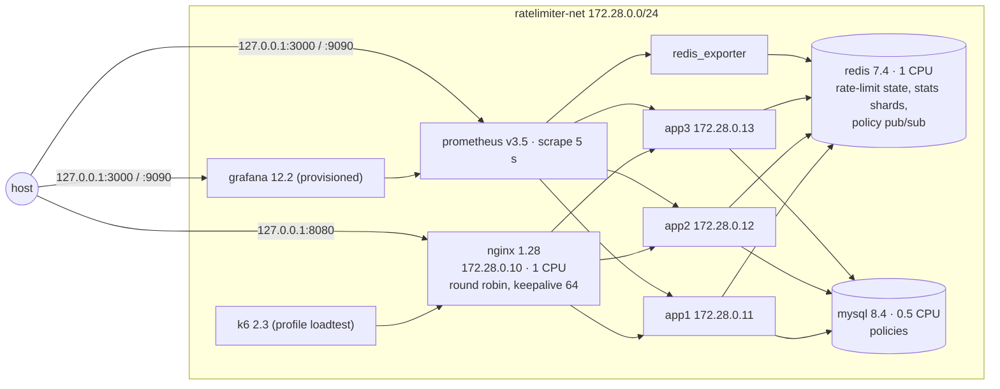
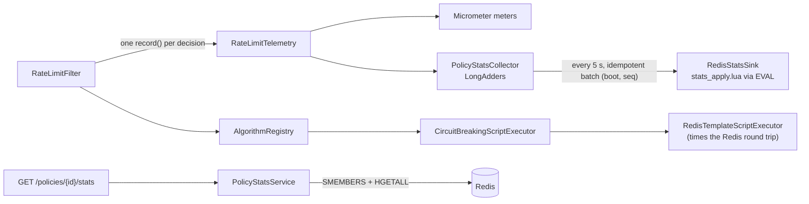

# 03 — System Architecture

> Status: **deployment architecture implemented and verified in Phase 3A; measured under load in Phase 3B** (`11-performance-benchmarks.md`, `13-failure-handling.md`). Request lifecycle and filter ordering: docs/07 ("Rate limiting over HTTP"). Phase 0 design: docs/00.

## Deployment (Docker Compose, Phase 3A)

| Service | Image | CPU / memory limit | Health check | Host port |
|---|---|---|---|---|
| nginx | nginx:1.28-alpine | 1.0 / 128 MiB | `/nginx-health` | 127.0.0.1:8080 (loopback only, SEC-1) |
| app1–app3 | `ratelimiter-app:local` (Dockerfile; JRE 17, non-root) | 1.5 / 1 GiB each | **`/actuator/health/readiness`** (R1) | none |
| redis | redis:7.4-alpine | 1.0 / 512 MiB | `redis-cli ping` | 127.0.0.1:6379 (dev) |
| mysql | mysql:8.4 | 0.5 / 512 MiB | `mysqladmin ping` | 127.0.0.1:3307 (dev) |
| redis-exporter | oliver006/redis_exporter:v1.78.0-alpine | 0.1 / 64 MiB | `/metrics` | none |
| prometheus | prom/prometheus:v3.5.0 | 0.5 / 512 MiB | `/-/ready` | 127.0.0.1:9090 |
| grafana | grafana/grafana:12.2.0 | 0.25 / 256 MiB | `/api/health` | 127.0.0.1:3000 |
| k6 | grafana/k6:2.3.0 | 2.0 / 1 GiB | — (run on demand) | none |

Key properties (all verified by `scripts/stack-smoke.sh`):
- **Single entry point.** Only Nginx is published for API traffic, on the host loopback address only (no TLS in this deployment; security review SEC-1). `/actuator/**` returns 404 at Nginx; Prometheus scrapes the instances on the internal network.
- **Client IP.** Nginx (static IP) is the only trusted proxy (`TRUSTED_PROXIES=172\.28\.0\.10`). The per-IP key carries the real caller's address, and a client-supplied `X-Forwarded-For` cannot change it.
- **Readiness-based health checks**, so a Redis or MySQL outage does not mark instances unhealthy (R1). Nginx itself uses passive health checks only (docs/13).
- **Stateless instances.** Quotas live in Redis and policies in MySQL with a per-instance cache. Each instance owns only its own `/stats` shard.
- **Deployment-specific Redis command timeout: 250 ms** (application default 50 ms; see decision D42 in docs/04).

## Components inside an instance (Phase 3A additions)

Telemetry is observation only (decision P1): the filter's responses are identical with and without it (`RateLimitFilterTelemetryTest`).
