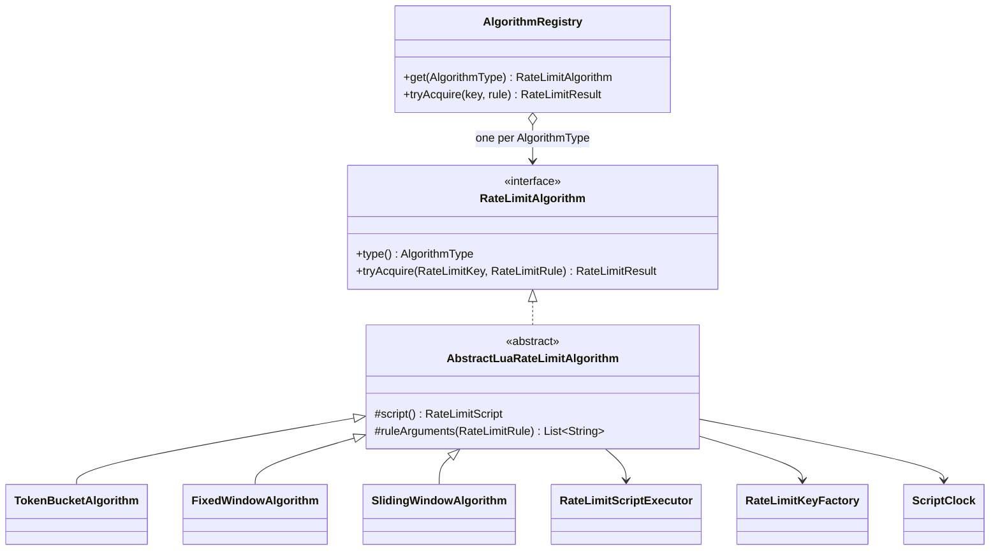

# 05 — Rate-Limiting Algorithms

> Status: **implemented and verified in Phase 2.** Scripts: `src/main/resources/scripts/*.lua`. Strategies: `com.utkarsh.ratelimiter.algorithm`.

## Common design



- **Strategy pattern.** `AlgorithmRegistry` maps each `AlgorithmType` to one implementation and fails at startup if one is missing or duplicated. Callers pass a `RateLimitRule`, and the registry dispatches on `rule.algorithm()`.
- **No HTTP, no database.** Algorithms take a `RateLimitKey` (policy id + subject) and a `RateLimitRule` (limit, window, refill) and return a `RateLimitResult`. Converting to headers, seconds and status codes is the web layer's job (Phase 4).
- **One script call per check.** Each check is a single `EVALSHA` on a single key. Every script returns `{allowed, remaining, retryAfterMs, resetAfterMs}` and takes the clock argument last.
- **Time.** Production scripts read `redis.call('TIME')` (see `RedisServerClock`). Tests use `ManualScriptClock`, which exists only in `src/test`. The production configuration hard-wires `RedisServerClock.INSTANCE`, so no property or bean can replace it.
- **Exact integer arithmetic.** Rules are bounded (`limit ≤ 10^6`, `100 ms ≤ window ≤ 24 h`), so every intermediate product is below 2^53 and exact in Lua's doubles (asserted in `RateLimitRuleTest`). Comparisons that involve fractions are multiplied out so no division is needed to decide admission.
- **Rejections write nothing.** In every algorithm the state after a rejection is a pure function of the stored state and the time, so a rejected request needs no write. This saves a write per rejected request, and abusive clients can't keep extending their key's TTL.

### Result fields

| Field | Meaning |
|---|---|
| `allowed` | Request may proceed |
| `limit` | Capacity / max per window |
| `remaining` | How many more requests would be allowed right now |
| `retryAfterMillis` | 0 if allowed; otherwise the **exact** earliest moment the same request would be allowed, assuming no other admissions in between |
| `resetAfterMillis` | Time until the full quota is available again (0 = already full) |

Every algorithm has a test that advances the clock by `retryAfter − 1` (still rejected) and then by `1` (allowed).

---

## A. Token Bucket

### Model
A bucket holds up to `C` tokens and gains `r = R / P` tokens per ms (`R` tokens per period `P`). A request takes one token. This allows bursts of up to `C` requests, then a sustained rate of `r`.

### Exact formulation
Tokens are stored as **units**, with one token = `P` units. The bucket then gains exactly `R` units per ms, an integer. A rate like 20 tokens / 60 000 ms becomes 20 units/ms instead of the repeating decimal 0.000333…

```
full = C·P                     cost = P
units(now) = min(full, units_stored + (now − ts)·R)      (only if now > ts)
allowed    ⇔ units(now) ≥ P
retry      = ⌈(P − units) / R⌉ ms
reset      = ⌈(full − units) / R⌉ ms   (after consuming, if allowed)
remaining  = ⌊units / P⌋
```

### Pseudocode
```
now ← Redis TIME (ms)
(u, ts) ← HMGET key u ts; if missing: u ← full, ts ← now      -- missing key = full bucket
if now > ts: u ← min(full, u + (now − ts)·R); ts ← now        -- clock going back adds nothing
if u ≥ P:
    u ← u − P; HSET key u ts; PEXPIRE key ⌈(full−u)/R⌉ + 1000
    return allowed
return rejected, retry = ⌈(P − u)/R⌉                          -- no write
```

### Example: C = 10, R = 10 per 10 s (1 token/s)
| t (ms) | Action | Units before → after | Result |
|---|---|---|---|
| 0 | 10 requests | 100 000 → 0 | all allowed; last: remaining 0, reset 10 000 |
| 0 | 11th | 0 | rejected, retry 1000 |
| 3 500 | requests | 35 000 → 5 000 after 3 | 3 allowed, then rejected with retry 500 |
| 10 000 + | idle 1 day | capped at 100 000 | 10 allowed, never more |

### Complexity
Time O(1) per request (HMGET + HSET + PEXPIRE). Space: one hash, 2 fields, per (policy, subject) with traffic in the last `time-to-full + 1 s`.

### Trade-offs
- ✅ Allows controlled bursts and smooth sustained rate; exact retry time; O(1).
- ❌ Two parameters (capacity, refill) are harder to explain to API consumers than "N per minute".
- **Use for:** public APIs that should absorb short bursts (page loads, batch clients) but cap sustained throughput.

---

## B. Fixed Window Counter

### Model
Time is cut into epoch-aligned windows `[k·W, (k+1)·W)`. Each window allows `L` requests.

```
k          = ⌊now / W⌋
allowed    ⇔ count_k < L
retry      = reset = (k+1)·W − now
remaining  = L − count_k
```

### Pseudocode
```
now ← Redis TIME; k ← ⌊now/W⌋
(w, c) ← HMGET key w c
if w = k: count ← c
elif w > k: k ← w; count ← c          -- clock moved back across a boundary: never reopen an old window
else: count ← 0                       -- stored count is from an older window
if count < L:
    if same window: HINCRBY key c 1
    else: HSET key w k c 1; PEXPIRE key (window end − now) + 1000
    return allowed
return rejected, retry = window end − now                     -- no write
```

### Why one key, not one key per window
The window index comes from Redis `TIME`, which is only known *inside* the script. A key name that depends on it would have to be built inside the script, but Redis Cluster requires every key a script touches to be passed in `KEYS`. So the window index is stored in the hash, and a stale count is recognized and ignored.

### The boundary-burst problem (reproduced in `FixedWindowScriptIT`)
Limit 5 per 60 s: 5 requests at `59.999 s` and 5 at `60.000 s` are all admitted, which is **10 requests in 2 ms**. In the worst case, any two adjacent windows allow `2L` requests in an arbitrarily short span around the boundary.

### Complexity
Time O(1) (HMGET + HINCRBY, or HSET + PEXPIRE on the first request of a window). Space: one hash, 2 fields.

### Trade-offs
- ✅ Simplest to explain ("100 per minute, resets on the minute"); cheapest; exact within a window.
- ❌ Boundary bursts up to 2×L; clients that know the boundary can line up requests on it.
- **Use for:** quotas where per-window totals matter more than smoothness (daily export limits, billing-style counts).

---

## C. Sliding Window Counter

### Model
Keep the count for the current window `c` and the previous window `p`. With `e = now − windowStart` (0 ≤ e < W), estimate the number of requests in the last `W` ms as:

```
estimate = p · (W − e) / W + c
```

This assumes the previous window's requests were spread evenly, and counts the fraction of them still inside the sliding window.

**Admission (exact integer form, multiplied by W):**
```
allowed  ⇔  estimate + 1 ≤ L  ⇔  p·(W − e) + (c + 1)·W ≤ L·W
remaining = ⌊(L·W − p·(W − e) − c·W) / W⌋
```

**Retry-After (closed form, cross-checked by brute-force search in `ScriptDifferentialIT`):**
- *Still inside this window*, if `c < L` and `p > 0`: `t = ⌈((W − e)·p − (L − c − 1)·W) / p⌉`, used if `t < W − e`.
- *Otherwise, in the next window* (`p' = c`, `c' = 0`): wait `(W − e) + e₂` with `e₂ = max(0, ⌈W·(c − L + 1) / c⌉)`.

**Reset** (estimate back to 0): `2W − e` if `c > 0`; `W − e` if only `p > 0`; else 0.

### Pseudocode
```
now ← Redis TIME; ws ← ⌊now/W⌋·W
(sws, c, p) ← HMGET key ws c p
if sws = ws:            keep c, p
elif sws = ws − W:      p ← c; c ← 0          -- roll into the next window
elif sws > ws:          ws ← sws               -- clock moved back: never rewind
else:                   c ← 0; p ← 0           -- older than one window: nothing counts
e ← max(0, now − ws)
if p·(W−e) + (c+1)·W ≤ L·W:
    c ← c+1; HSET key ws c p; PEXPIRE key 2W − e + 1000
    return allowed
return rejected, retry (closed form above)            -- no write
```

### Worked example: L = 10, W = 10 s
10 requests in window k. In window k+1 the number admitted at offset `e` is `⌊10·e/W⌋` (tested):

| e | 0 | 1 000 | 2 500 | 5 000 | 7 500 | 9 999 |
|---|---|---|---|---|---|---|
| previous weight | 10 | 9 | 7.5 | 5 | 2.5 | 0.001 |
| admitted | 0 | 1 | 2 | 5 | 7 | 9 |

At `e = 2 500`, 2 requests are admitted (8.5, then 9.5); the third would make 10.5. The retry is 500 ms, because at `e = 3 000`: 10·0.7 + 2 + 1 = 10.

### The approximation, quantified
- **Boundary bursts are smoothed.** The same 10-at-the-boundary traffic that lets a fixed window admit 20 in 2 ms admits **0** in the first millisecond after the boundary (test `boundaryBurstIsSmoothedComparedWithFixedWindow`). In general, within `d` ms after a full previous window, at most about `L·d/W` more requests are admitted.
- **It is not exact.** If the previous window's requests were bunched at its end, the estimate undercounts them. Test `approximationCanExceedTheLimitInTheTrueSlidingWindowWhenTrafficIsSkewed`: 10 requests at the last ms of window k, then 9 admitted near the end of window k+1 → **19 requests in one true 10 s interval (1.9 × L)**. The worst case approaches `2L` per true sliding window. Unlike the fixed window, that excess is spread across a whole window, not concentrated at a boundary.
- **Under evenly spread traffic** the estimate is exact on average, and errors in both directions are bounded by the unevenness of the previous window.

### Sliding Window Counter vs Sliding Window Log
| | Counter (implemented) | Log (not implemented) |
|---|---|---|
| State per client | 1 hash, 3 integers | Sorted set with one member per request in the last W |
| Memory at L = 1 000/min | ~100 bytes | Up to 1 000 members; tens of KB |
| Memory, 100k such clients | ~10 MB | Several GB |
| Cost per request | O(1) | O(log N) insert + O(M) trimming |
| Accuracy | Approximate (above) | Exact |
| Same-millisecond requests | No issue | Need unique members (extra counter) |

The counter was chosen (decision D1) because its memory doesn't grow with the limit and its error is bounded and documented. (The figures in this table are estimates. Measured in Phase 3B with `MEMORY USAGE` on the 120/60 s benchmark policy: 104 bytes per fixed-window key, 112 bytes per token-bucket or sliding-window key; see `11-performance-benchmarks.md`.)

### Trade-offs
- ✅ O(1) memory and time, no boundary bursts, a single key.
- ❌ Approximate; reset and retry formulas are less intuitive to explain to clients.
- **Use for:** per-user API limits where smoothness matters and memory per client must stay constant.

---

## Comparison

| | Token Bucket | Fixed Window | Sliding Window Counter |
|---|---|---|---|
| Burst at window boundary | Up to capacity (by design) | Up to 2L in ms | Smoothed (≈ L·d/W) |
| Worst case in one true window | C + R·W/P | 2L | → 2L, spread over the window |
| Accuracy | Exact for its model | Exact per window | Approximate |
| Redis ops per allowed request | HMGET, HSET, PEXPIRE | HMGET, HINCRBY (+HSET, PEXPIRE once per window) | HMGET, HSET, PEXPIRE |
| Redis ops per rejected request | HMGET | HMGET | HMGET |
| State | Hash (2 fields) | Hash (2 fields) | Hash (3 fields) |
| Key TTL | time to full + 1 s | window end + 1 s | 2W − e + 1 s |
