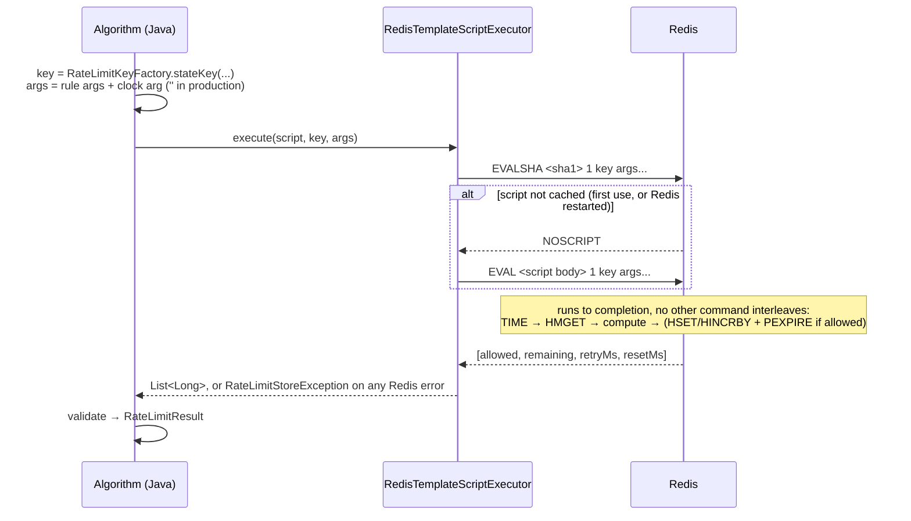

# 06 — Redis Data Design

> Status: **rate-limit state implemented and verified (Phase 2).** Statistics shards and the invalidation channel are designed here and implemented in Phases 3 and 6.

## Server configuration (Phase 1, verified with `CONFIG GET`)

| Setting | Value | Reason |
|---|---|---|
| Image | `redis:7.4-alpine` | Scripts call `TIME` before writing (allowed with effects replication, the default since 7.0) |
| `save ""`, `appendonly no` | persistence off | State is short-lived; a restart resets quotas (documented failure mode) |
| `maxmemory` | 256 MB | Bounded footprint in local Docker |
| `maxmemory-policy` | `volatile-ttl` | Every rate-limit key has a TTL; evict nearly-expired keys first |
| `slowlog-log-slower-than` | 5000 µs | Any script slower than 5 ms is suspicious |
| `protected-mode no` | — | No password locally; the port is published on host loopback only |

## Key naming

```
<prefix>:{<policyId>:<u|ip>:<subject>}:<tb|fw|sw>
```

| Part | Source | Notes |
|---|---|---|
| `prefix` | `ratelimiter.key-prefix` (default `rl`) | Validated `[a-z0-9]{1,16}` |
| `{…}` | hash tag | All state for one (policy, subject) is in one Cluster slot, so scripts never go cross-slot |
| `policyId` | policy primary key | Bounded by the number of policies; never the raw URL |
| `u` / `ip` | `SubjectType` | Same id string as a user and as an IP never collides |
| `subject` | user id / IP | Kept readable if it matches `[A-Za-z0-9._:@-]{1,128}` (covers IPv4, IPv6, typical ids); otherwise `#<sha256 hex>`. Raw subjects can't contain `#`, so a raw subject can't collide with a hashed one |
| `tb` / `fw` / `sw` | `AlgorithmType` | Switching a policy's algorithm starts fresh state instead of reading another format |

Examples: `rl:{7:u:u123}:tb`, `rl:{7:ip:203.0.113.7}:fw`, `rl:{9:ip:2001:db8::1}:sw`, `rl:{1:u:#9f86d0…}:tb`.

## State per algorithm

| Algorithm | Type | Fields | Written when | TTL (set by the script) |
|---|---|---|---|---|
| Token bucket | Hash | `u` = tokens × period (integer units), `ts` = last refill ms | Allowed requests only | time until full + 1 s |
| Fixed window | Hash | `w` = window index ⌊now/W⌋, `c` = count | Allowed requests only (`HINCRBY` within a window; `HSET` + `PEXPIRE` when a window opens) | window end + 1 s |
| Sliding window counter | Hash | `ws` = current window start ms, `c` = current count, `p` = previous count | Allowed requests only | 2W − e + 1 s |

### TTL invariant: never early, possibly late
A missing key means "fresh state" in every algorithm (full bucket, zero count). So a key may disappear **once** its state has become equivalent to fresh, and **never before**:

- **Late expiry is harmless.** Scripts check the stored window index / timestamp, so stale state is recognized and ignored.
- **Early expiry would over-admit.** It erases a count that still applies. Phase 2 tests found this: with TTL equal to exactly the time left, a request in a window's last millisecond set a 1 ms TTL, the key vanished, and the window restarted (103 admitted instead of 5). In production a similar 1 ms gap exists, because Redis computes `PEXPIRE` from the time cached at script start, while `TIME` reads the live clock.
- **Fix:** every TTL gets **+1 s grace** (regression test `keyNeverExpiresBeforeItsWindowEnds`). The cost is that idle keys live 1 s longer.

Rejected requests do not touch the TTL, so a client that keeps hammering a rejected key does not keep it alive.

## Lua execution flow



- `EVALSHA` / `NOSCRIPT` fallback is provided by Spring Data Redis (`RedisTemplate.execute(RedisScript, …)`), so the script body crosses the network only on a cache miss.
- **Atomicity:** Redis runs one script at a time on its main thread. The read, the decision and the write in one script cannot interleave with another client's script on the same key. See `09-concurrency-and-distributed-correctness.md`.
- **Replies are integers only.** Lua numbers are truncated to integers in RESP replies, so scripts return whole milliseconds and counts. The executor rejects any non-integer element.
- **Failures** (connection refused, command timeout, unexpected reply) surface as `RateLimitStoreException` and are handled by the failure mode and circuit breaker (Phase 2; `13-failure-handling.md`). The command timeout is 50 ms by default and 250 ms in the Compose deployment (D14, D42).

## Memory considerations
- One small hash per *active* (policy, subject). Redis stores small hashes as listpacks. **Measured in Phase 3B** (`MEMORY USAGE`, valid B1 runs, `11-performance-benchmarks.md`): 104 bytes per fixed-window key and 112 bytes per token-bucket or sliding-window key. 1 million active subjects ≈ 105–112 MB.
- Idle subjects cost nothing: keys expire once equivalent to fresh.
- `volatile-ttl` eviction under memory pressure drops nearly-expired keys first. Those are the ones closest to being fresh anyway, so eviction causes the least over-admission it can.

## Statistics and invalidation keys (Phase 3A)

| Purpose | Key | Type | TTL | Phase |
|---|---|---|---|---|
| Statistics shard | `rl:stats:{<policyId>}:<instanceId>` | Hash `allowed`, `rejected`, `fail_open`, `fail_closed`, `boot`, `seq`, `last_flush_ms` | 24 h, refreshed on each flush | ✅ 3A |
| Statistics instance index | `rl:stats:{<policyId>}:instances` | Set of instance ids | 24 h, refreshed on each flush | ✅ 3A |
| Policy invalidation | `rl:policy-events` | Pub/Sub channel | — | ✅ 2 |

Statistics are **sharded per instance** (decision D9, implemented in 3A). Each instance writes only its own key every **5 s**, so no key is incremented by all traffic. `/stats` sums the shards. Counts not yet flushed are lost if an instance crashes; enforcement never reads them.

**`stats_apply.lua`** (sent with plain `EVAL`, decision D41) applies one batch to one shard atomically and **at most once**. If the shard's stored `(boot, seq)` already covers the batch, it returns 0 and changes nothing. Otherwise it runs `HINCRBY` on the four counters, stores `boot`/`seq`/`last_flush_ms` (from Redis `TIME`), refreshes the TTL, and adds the instance to the index set. Both keys share the `{policyId}` hash tag. Verified against real Redis, including a flush that timed out while Redis was paused and then executed later (`StatsApplyScriptIT`): no double count.

## Hot keys
A single very active subject maps to a single key, and therefore a single Redis thread and Cluster slot. Sharding does not help one key. Measured in Phase 3B (B8: one user at 2,000 and 5,000 RPS, all valid; `11-performance-benchmarks.md`). Possible mitigations (not implemented): local negative caching of rejections until `retryAfter`, and per-instance pre-limits.
