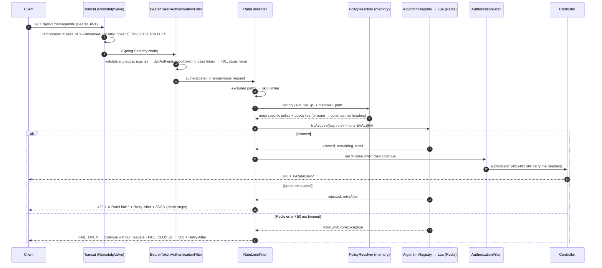

# 07 — API Documentation

> Status: **policy management, identity, the HTTP rate-limiting filter, and the 429/503 response contract are implemented and verified** (Phase 2, workstreams 2B and 2C). `/policies/{id}/stats` and `/actuator/prometheus` were added in Phase 3A.
>
> OpenAPI: in the `dev` profile, `GET /v3/api-docs` (JSON) and `/swagger-ui.html`. Disabled in every other profile.

## Endpoint overview

| Method | Path | Auth | Profiles | Purpose |
|---|---|---|---|---|
| POST | `/api/v1/policies` | `ROLE_ADMIN` | all | Create a policy |
| GET | `/api/v1/policies?page=&size=` | `ROLE_ADMIN` | all | List policies (paged, by id) |
| GET | `/api/v1/policies/{id}` | `ROLE_ADMIN` | all | Get a policy |
| PUT | `/api/v1/policies/{id}` | `ROLE_ADMIN` | all | Replace a policy (optimistic locking) |
| DELETE | `/api/v1/policies/{id}` | `ROLE_ADMIN` | all | Delete a policy |
| GET | `/api/v1/policies/{id}/stats` | `ROLE_ADMIN` | all | Per-policy decision totals across instances (Phase 3A) |
| GET | `/actuator/prometheus` | none (internal network only; Nginx returns 404) | all | Prometheus scrape (Phase 3A) |
| POST | `/api/v1/auth/demo-token` | none | **dev only** | Mint a test JWT |
| GET | `/api/v1/demo/whoami` | optional | **dev only** | Show resolved identity and policy |
| GET | `/api/v1/demo/public` | optional | all | Demo: anonymous allowed (limited per IP) |
| GET | `/api/v1/demo/profile` | any token | all | Demo: caller's tier policy |
| GET | `/api/v1/demo/premium` | PREMIUM / ENTERPRISE (else 403) | all | Demo: caller's tier policy |
| GET | `/api/v1/demo/enterprise` | ENTERPRISE (else 403) | all | Demo: endpoint-specific policy `demo-enterprise-endpoint` (50/min, sliding window, FAIL_CLOSED) |
| GET | `/actuator/health/liveness`, `/readiness` | none | all | Probes |

"dev only" means: the endpoint exists only when `ratelimiter.dev-endpoints.enabled=true` (set in `application-dev.yml`) **and** the `prod` profile is not active (`@Profile("!prod")`). `DevEndpointsDisabledIT` verifies that forcing the property on under `prod` still leaves them absent.

## Authentication

Bearer JWTs, HS256, verified by Spring Security's OAuth2 resource server.

| Check | Rule | On failure |
|---|---|---|
| Signature | HMAC-SHA256 with `JWT_SECRET` (base64, ≥ 32 bytes; startup fails otherwise) | 401 |
| `exp` / `nbf` | Validated with 30 s clock skew | 401 |
| `iss` | Must equal `ratelimiter.security.jwt.issuer` (`distributed-rate-limiter`) | 401 |
| `sub` | The user id used for per-user quotas | — |
| `tier` | `FREE` / `PREMIUM` / `ENTERPRISE`. Missing, unknown or `ANONYMOUS` → **FREE** (never more privilege than the claim states) | — |
| `roles` | List; `["ADMIN"]` grants `ROLE_ADMIN` | 403 on admin endpoints |

An invalid token is **rejected with 401 even on endpoints that allow anonymous access**; it is never silently treated as anonymous. Requests without a token are anonymous: tier `ANONYMOUS`, identified by client IP.

Example token payload:
```json
{ "iss": "distributed-rate-limiter", "sub": "alice", "tier": "PREMIUM", "roles": [], "iat": 1794328000, "exp": 1794328900 }
```

## Client IP and proxies

The client IP is `HttpServletRequest.getRemoteAddr()`. Tomcat's `RemoteIpValve` rewrites it from `X-Forwarded-For` **only** when the TCP peer matches `TRUSTED_PROXIES` (`server.tomcat.remoteip.internal-proxies`, a regex). It then takes the right-most address that is not itself a trusted proxy.

| `TRUSTED_PROXIES` | Peer | `X-Forwarded-For` | Client IP |
|---|---|---|---|
| empty (default) | 198.51.100.4 | `6.6.6.6` | 198.51.100.4 (header ignored) |
| `127\.0\.0\.1` | 127.0.0.1 | `203.0.113.9` | 203.0.113.9 |
| `127\.0\.0\.1` | 127.0.0.1 | `6.6.6.6, 203.0.113.9` | 203.0.113.9 (spoofed left entry ignored) |
| `127\.0\.0\.1` | 127.0.0.1 | `6.6.6.6, 203.0.113.9, 127.0.0.1` | 203.0.113.9 (trusted hop skipped) |

Spoofing consideration: anything left of the first untrusted hop is client-controlled. If the edge proxy *appends* to an incoming header (Nginx `$proxy_add_x_forwarded_for`), the right-most untrusted entry is still the real peer of the edge proxy. The full Compose stack's Nginx configuration will set `TRUSTED_PROXIES` to the Nginx container address only.

## Policy resource

### Request body (POST, PUT)

| Field | Type | Required | Constraints |
|---|---|---|---|
| `name` | string | yes | `[a-z0-9][a-z0-9-]*`, ≤ 100, unique |
| `description` | string | no | ≤ 500 |
| `httpMethod` | string | no | `GET HEAD POST PUT PATCH DELETE OPTIONS`; null = any |
| `endpointPattern` | string | yes | Spring `PathPattern` starting with `/`, ≤ 255, must parse (e.g. `/api/v1/orders/**`, `/api/v1/orders/{id}`) |
| `tier` | enum | no | `ANONYMOUS FREE PREMIUM ENTERPRISE`; null = any |
| `keyBy` | enum | yes | `USER` (anonymous → IP) or `IP` |
| `algorithm` | enum | yes | `TOKEN_BUCKET FIXED_WINDOW SLIDING_WINDOW` |
| `limit` | int | yes | 1 – 1,000,000 (capacity, or max per window) |
| `windowMs` | long | yes | 100 – 86,400,000 (window, or refill period) |
| `refillTokens` | int | no | 1 – 1,000,000; **TOKEN_BUCKET only**; default = `limit` |
| `failureMode` | enum | no | `FAIL_OPEN FAIL_CLOSED`; null = global default |
| `priority` | int | no | −1000 – 1000, default 0; final tie-break |
| `enabled` | boolean | no | default true; disabled policies are not loaded |
| `version` | int | **PUT only** | Must equal the stored version |

### Response body

```json
{
  "id": 5, "name": "premium-orders", "description": null,
  "httpMethod": "POST", "endpointPattern": "/api/v1/orders/**",
  "tier": "PREMIUM", "keyBy": "USER", "algorithm": "SLIDING_WINDOW",
  "limit": 30, "windowMs": 60000, "refillTokens": null,
  "failureMode": null, "priority": 0, "enabled": true, "version": 0,
  "createdAt": "2026-11-10T16:47:20.690569Z", "updatedAt": "2026-11-10T16:47:20.690581Z"
}
```

### Status codes

| Code | When |
|---|---|
| 201 | Created; `Location: /api/v1/policies/{id}` |
| 200 | Read / updated |
| 204 | Deleted |
| 400 | Validation failed (field list in `errors`); unparsable pattern; unknown enum value; PUT without `version`; page size > 100; MySQL CHECK violation (error 3819, defence in depth) |
| 401 | Missing, malformed, expired, wrongly signed or wrong-issuer token |
| 403 | Valid token without `ROLE_ADMIN` |
| 404 | No policy with that id |
| 409 | Duplicate name (MySQL 1062), or stale `version` |
| 503 | Policy database unreachable (admin API only; request handling continues from the in-memory snapshot) |

### Examples (captured from the dev profile against Docker Compose)

```bash
curl -s -X POST localhost:8080/api/v1/auth/demo-token -H 'Content-Type: application/json' \
  -d '{"userId":"admin-1","tier":"ENTERPRISE","roles":["ADMIN"]}'
# {"accessToken":"eyJ...","tokenType":"Bearer","expiresIn":900}
```

```bash
curl -s -i -X POST localhost:8080/api/v1/policies -H "Authorization: Bearer $ADMIN" -H 'Content-Type: application/json' \
  -d '{"name":"premium-orders","endpointPattern":"/api/v1/orders/**","httpMethod":"POST","tier":"PREMIUM","keyBy":"USER","algorithm":"SLIDING_WINDOW","limit":30,"windowMs":60000}'
# HTTP/1.1 201
# Location: /api/v1/policies/5
```

Validation error (`400`, `application/problem+json`):
```json
{"type":"about:blank","title":"Invalid request","status":400,"detail":"Request body failed validation",
 "instance":"/api/v1/policies",
 "errors":[{"field":"limit","message":"must be greater than or equal to 1"},
           {"field":"name","message":"lowercase letters, digits and '-'"},
           {"field":"refillTokens","message":"refillTokens applies only to TOKEN_BUCKET"}]}
```

Conflict (`409`):
```json
{"type":"about:blank","title":"Conflict","status":409,"detail":"A policy named 'premium-orders' already exists","instance":"/api/v1/policies"}
```

### Optimistic locking
PUT replaces the whole policy and must carry the `version` the client read. If another admin changed the policy in between, the version no longer matches → **409**, and nothing is overwritten. A PUT that changes nothing is idempotent: no UPDATE is issued and `version` does not increase.

### Propagation to all instances
After the transaction **commits**, the instance that handled the change reloads its snapshot and publishes a message on Redis channel `rl:policy-events`. Every other instance reloads from MySQL on receipt. Messages contain no policy data. If a message is lost (Redis outage, disconnected subscriber), the periodic reload (`ratelimiter.policy.reload-interval`, 30 s) brings the instance up to date. Measured in `PolicyPropagationIT`: changes visible on all three instances within the 3 s test bound via pub/sub, and within 5 s via the periodic reload alone (interval set to 1 s).

## Policy resolution

For each request (in memory, no database access), among enabled policies matching the method, path and caller tier:
1. Tier-specific beats any-tier.
2. More specific path pattern wins (`PathPattern.SPECIFICITY_COMPARATOR`).
3. Method-specific beats any-method.
4. Higher `priority`, then lower `id`.

No match → no limit applies. The quota key is `(policyId, USER:<sub>)` for `keyBy=USER` with an authenticated caller, otherwise `(policyId, IP:<client ip>)`.

## Development-only endpoints

### `POST /api/v1/auth/demo-token`
| Field | Rule |
|---|---|
| `userId` | `[A-Za-z0-9._@-]{1,64}` |
| `tier` | `ANONYMOUS FREE PREMIUM ENTERPRISE` (ANONYMOUS is mapped to FREE when the token is used) |
| `roles` | optional; only `ADMIN` |
| `ttlSeconds` | optional; default 900; capped at `ratelimiter.dev-endpoints.max-token-ttl` (1 h) |

### `GET /api/v1/demo/whoami?method=GET&path=/api/v1/demo/hello`
```json
{"userId":"alice","tier":"PREMIUM","clientIp":"0:0:0:0:0:0:0:1","policyId":5,"policyName":"premium-orders",
 "algorithm":"SLIDING_WINDOW","limit":30,"windowMs":60000,"quotaSubject":"USER:alice"}
```

## Health

| Endpoint | Contents | Purpose |
|---|---|---|
| `/actuator/health/readiness` | `readinessState`, `policies` | Load balancer: route traffic here? (R1: Redis/MySQL outages do **not** make an instance unready) |
| `/actuator/health/liveness` | `livenessState` | Restart decisions |
| `/actuator/health/dependencies` | `db`, `redis`, `rateLimitStore` | Monitoring: dependency health and the Redis circuit breaker (`rateLimitStore` is OUT_OF_SERVICE when the breaker is OPEN or HALF_OPEN; details: state, failure rate, not-permitted calls) |

The `policies` contributor is UP once a snapshot exists (source `DATABASE`, or `FALLBACK` in development). Its details (shown in dev) include source, policy count, reload counters, `loadedAt` and the last error.

## Rate limiting over HTTP

### HTTP request lifecycle and filter ordering



| Position | Filter | Why here |
|---|---|---|
| Tomcat valve | `RemoteIpValve` | Client IP fixed before any application code; forwarding headers honoured only from trusted proxies |
| Security chain | `BearerTokenAuthenticationFilter` | JWT validated, so the identity is known |
| **Directly after it** | **`RateLimitFilter`** (`addFilterAfter(..., BearerTokenAuthenticationFilter.class)`) | Per-user quotas need the identity; running **before** authorization means requests that end in 401/403 still use quota, which throttles probing of protected endpoints |
| Later | `ExceptionTranslationFilter`, `AuthorizationFilter` | 401/403 |

- **Registered once.** The filter is a bean, but its automatic servlet registration is disabled (`FilterRegistrationBean.setEnabled(false)`); it runs only inside the security chain.
- **Counted once.** `OncePerRequestFilter` skips ERROR and ASYNC re-dispatches, so a 404 or a controller error is not counted twice (tested).
- **Not limited:** `ratelimiter.filter.excluded-paths`: `/actuator/**`, `/v3/api-docs/**`, `/swagger-ui/**`, `/swagger-ui.html`, `/api/v1/auth/**`, `/error`. Excluded requests never touch the policy snapshot or Redis.
- **Requests no policy covers** continue without headers and without any Redis call.
- **Cost per covered request:** one in-memory policy lookup and one Redis round trip. No database access.

### Response contract

| Header | On | Value |
|---|---|---|
| `X-RateLimit-Limit` | 2xx/4xx of covered requests, and 429 | Policy limit (capacity, or max per window) |
| `X-RateLimit-Remaining` | same | Requests that would still be allowed right now; `0` on 429 |
| `X-RateLimit-Reset` | same | **Delta seconds** (rounded up) until the full quota is available again; `0` only when already full |
| `Retry-After` | 429, 503 | Whole seconds, **rounded up**, minimum 1 (never invites a retry that would be rejected) |

What `Reset` and `Retry-After` mean per algorithm (from the scripts' exact millisecond values, see docs/05):

| Algorithm | `Retry-After` on 429 | `X-RateLimit-Reset` |
|---|---|---|
| Token bucket | Time until one token has refilled | Time until the bucket is full |
| Fixed window | Time until the window ends | Time until the window ends (same value) |
| Sliding window counter | Earliest time the weighted estimate fits one more request | Time until both windows have slid out (up to 2 × window) |

When Redis is unavailable and the policy **fails open**, the request continues **without** `X-RateLimit-*` headers. The quota is unknown, and inventing numbers would mislead clients.

**Circuit breaker (2D).** After repeated Redis infrastructure failures the breaker opens. For 5 s, requests get their failure mode immediately (~1 ms instead of the 50 ms timeout) without contacting Redis; the responses are identical to the fail-open and fail-closed responses above. Then 3 real requests probe Redis; all three must succeed to resume normal limiting. Details: `docs/proposals/2D-redis-circuit-breaker.md`.

### 429 Too Many Requests
RFC 7807 problem document, extended with the project's contract fields (`error`, `message`, `retryAfterSeconds`). Captured from the dev profile:

```
HTTP/1.1 429
X-RateLimit-Limit: 20
X-RateLimit-Remaining: 0
X-RateLimit-Reset: 60
Retry-After: 3
Content-Type: application/problem+json;charset=UTF-8

{"type":"about:blank","title":"Too Many Requests","status":429,"error":"Too Many Requests",
 "message":"Rate limit exceeded","detail":"Rate limit exceeded","retryAfterSeconds":3,
 "instance":"/api/v1/demo/profile","timestamp":"2026-11-10T17:03:18.777718Z"}
```
The controller is not invoked.

### Successful response
```
HTTP/1.1 200
X-RateLimit-Limit: 20
X-RateLimit-Remaining: 19
X-RateLimit-Reset: 3
Content-Type: application/json

{"endpoint":"profile","userId":"alice","tier":"FREE"}
```
(FREE tier token bucket: 20 tokens, one refilled every 3 s, so after one request the bucket is full again in 3 s.)

### 503 Service Unavailable (fail-closed infrastructure failure)
Only when the rate-limit store cannot be consulted **and** the effective failure mode is FAIL_CLOSED (the policy's `failureMode`, else `ratelimiter.default-failure-mode`). **Never 429**: the client did not exceed anything.

```
HTTP/1.1 503
Retry-After: 5

{"type":"about:blank","title":"Service Unavailable","status":503,"error":"Service Unavailable",
 "message":"Rate limiting is temporarily unavailable","detail":"Rate limiting is temporarily unavailable",
 "retryAfterSeconds":5,"instance":"/api/v1/demo/enterprise","timestamp":"2026-11-10T17:03:18.898097Z"}
```
`Retry-After` = `ratelimiter.filter.fail-closed-retry-after` (5 s).

### Demo endpoints and the policies they exercise (seed data)

| Request | Policy applied | Algorithm | Limit |
|---|---|---|---|
| anonymous `GET /public` | anonymous-default (per IP) | Sliding window | 10 / min |
| FREE token, any demo endpoint | free-tier | Token bucket | 20, refill 20/min |
| PREMIUM token, `/premium` or `/profile` | premium-tier | Token bucket | 100, refill 100/min |
| ENTERPRISE token, `/profile`, `/premium` | enterprise-tier | Token bucket | 1000, refill 1000/min |
| ENTERPRISE token, `/enterprise` | demo-enterprise-endpoint (V3) | Sliding window, FAIL_CLOSED | 50 / min |

The policy management API itself is under `/api/**`, so admin calls are also limited by the caller's tier policy.

### Configuration

| Property | Default | Meaning |
|---|---|---|
| `ratelimiter.filter.enabled` | `true` | Master switch |
| `ratelimiter.filter.excluded-paths` | see above | PathPatterns never limited |
| `ratelimiter.filter.fail-closed-retry-after` | `5s` | `Retry-After` on 503 |
| `ratelimiter.default-failure-mode` | `FAIL_OPEN` | When a policy has no override |
| `spring.data.redis.timeout` | `50ms` | Command timeout before the failure mode applies |
| `ratelimiter.circuit-breaker.*` | window 20, minimum 10, 50 %, open 5 s, 3 probes, probe timeout 2 s | Redis circuit breaker (see docs/13) |

## Policy statistics: `GET /api/v1/policies/{id}/stats` (Phase 3A)

| Code | When |
|---|---|
| 200 | Totals for an existing policy |
| 401 / 403 | No token / not `ROLE_ADMIN` |
| 404 | No policy with that id |
| 503 | Policy database unreachable (existence check) |

| Field | Meaning |
|---|---|
| `allowed`, `rejected` | Decisions made by Redis (200, 429) |
| `failOpen`, `failClosed` | Decisions made by the failure mode while Redis was unavailable |
| `rejectionRate` | rejected / (allowed + rejected) |
| `instances[]` | Per instance: the same counters plus `lastFlushAt` |
| `consistency` | Eventual: each instance flushes every 5 s; unflushed counts of a crashed instance are lost |

Totals are cumulative since each instance shard was created; shards expire 24 h after their last flush. The call itself is a rate-limited admin request (it counts against the admin's tier policy). An actual response is shown in docs/12.
