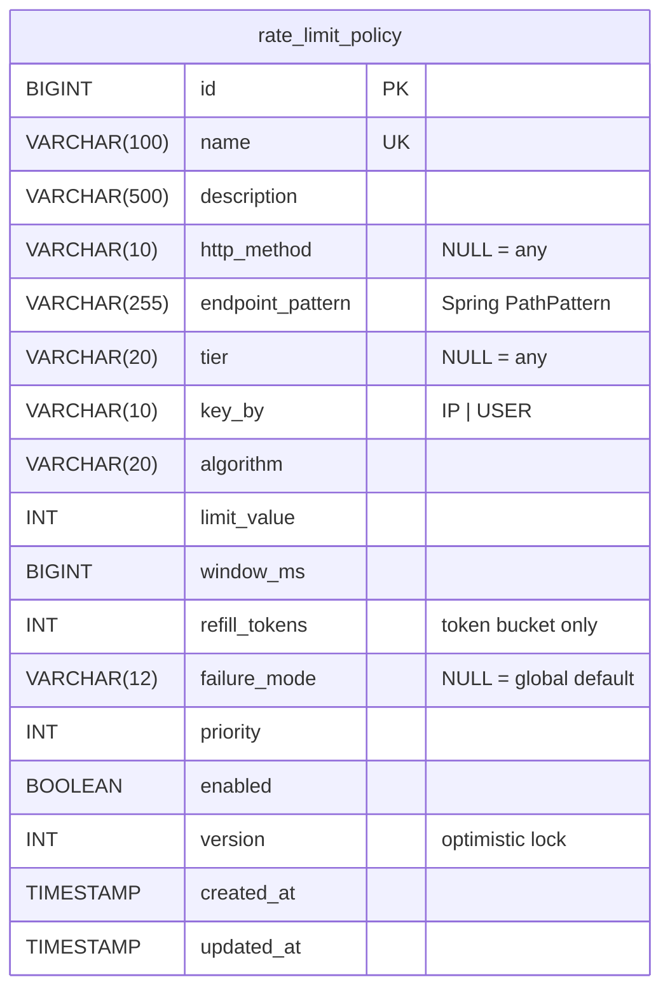

# 08 — Database Schema

> Status: **schema implemented in Phase 1; JPA mapping, constraint error handling and startup behaviour added and verified in Phase 2 (Policy Management & Identity).**

MySQL 8.4 stores rate-limit **policies** only. Request state lives in Redis. MySQL is read when an
instance loads or reloads its policy snapshot, never per request.

## Migrations (Flyway)

| Version | File | Purpose |
|---|---|---|
| V1 | `src/main/resources/db/migration/V1__create_rate_limit_policy.sql` | Create `rate_limit_policy` with constraints and index |
| V2 | `src/main/resources/db/migration/V2__seed_default_policies.sql` | Seed the four tier policies |
| V3 | `src/main/resources/db/migration/V3__seed_demo_endpoint_policy.sql` | Endpoint-specific demo policy `demo-enterprise-endpoint` (ENTERPRISE, `GET /api/v1/demo/enterprise`, sliding window 50/min, FAIL_CLOSED) |

Rules: migrations are append-only (never edit an applied file, add `V3__…`); `validate-on-migrate`
is on; `clean` is disabled; Hibernate runs with `ddl-auto=validate`, so Flyway alone owns the schema.

## `rate_limit_policy`

| Column | Meaning |
|---|---|
| `http_method` | Restricts the policy to one method; `NULL` matches all |
| `endpoint_pattern` | Spring `PathPattern` (e.g. `/api/v1/orders/**`). Redis keys use the policy id, never the raw path |
| `tier` | `ANONYMOUS`, `FREE`, `PREMIUM`, `ENTERPRISE`, or `NULL` for any tier |
| `key_by` | `USER` counts per user (falls back to IP for anonymous callers); `IP` counts per client IP |
| `limit_value` | Token-bucket capacity, or max requests per window |
| `window_ms` | Window length, or token-bucket refill period |
| `refill_tokens` | Token bucket only: tokens added per `window_ms` (`NULL` → `limit_value`) |
| `failure_mode` | Per-policy override of the global fail-open/closed default |
| `priority` | Final tie-break in policy resolution |
| `version` | Optimistic locking for concurrent admin updates |

### Constraints (verified)

| Constraint | Rule |
|---|---|
| `uk_rate_limit_policy_name` | Unique policy name |
| `chk_policy_limit` | `limit_value` between 1 and 1,000,000 |
| `chk_policy_window` | `window_ms` between 100 ms and 24 h |
| `chk_policy_refill` | `refill_tokens` only for `TOKEN_BUCKET`, between 1 and 1,000,000 |
| `chk_policy_http_method`, `chk_policy_tier`, `chk_policy_key_by`, `chk_policy_algorithm`, `chk_policy_failure_mode` | Enumerated values |
| `chk_policy_pattern` | Pattern starts with `/` |

MySQL reports CHECK violations as error **3819** (SQLState `HY000`). Spring's translator maps this to
`UncategorizedSQLException`, not `DataIntegrityViolationException`.

### Constraint error handling (implemented)

The API validates every field first (Bean Validation on `PolicyRequest`, plus `PathPattern` parsing and the
rejection of `{var:regex}` variables in
the service), so constraint errors normally can't happen. If they do, for example because of a manual
insert or validation drifting from the schema, `PolicyStore` reads the vendor code from the cause chain
(`MySqlErrors`):

| MySQL error | Meaning | Domain exception | HTTP |
|---|---|---|---|
| 3819 `ER_CHECK_CONSTRAINT_VIOLATED` | CHECK failed; constraint name parsed from the message and mapped to the API field (`chk_policy_limit` → `limit`, …) | `InvalidPolicyException` | 400 |
| 1062 `ER_DUP_ENTRY` | Unique name taken (also the race where two admins create the same name) | `PolicyConflictException` | 409 |
| other | — | rethrown unchanged | 500 |

Verified against real MySQL in `PolicyConstraintIT` by saving entities that bypass API validation.

### Seed data

| name | tier | key_by | algorithm | limit | window |
|---|---|---|---|---|---|
| anonymous-default | ANONYMOUS | IP | SLIDING_WINDOW | 10 | 60 s |
| free-tier | FREE | USER | TOKEN_BUCKET | 20 | 60 s |
| premium-tier | PREMIUM | USER | TOKEN_BUCKET | 100 | 60 s |
| enterprise-tier | ENTERPRISE | USER | TOKEN_BUCKET | 1,000 | 60 s |

## JPA mapping

`com.utkarsh.ratelimiter.policy.RateLimitPolicy`. Enums are stored as strings (`@Enumerated(STRING)`),
matching the CHECK lists. `version` is a JPA `@Version` column for optimistic locking.
`created_at`/`updated_at` are set by Hibernate (`@CreationTimestamp`/`@UpdateTimestamp`) in UTC.

| Setting | Profile | Value | Why |
|---|---|---|---|
| `ddl-auto` | base / prod | `none` | The app must start while MySQL is down (see below) |
| `ddl-auto` | test | `validate` | Every integration test checks the mapping against real MySQL |
| `hibernate.boot.allow_jdbc_metadata_access` | base / prod | `false` | No connection while booting; the dialect comes from `jakarta.persistence.database-product-name/-version` (MySQL 8.4) |

## Startup with MySQL unreachable

| Step | Behaviour |
|---|---|
| Flyway at startup | `DeferredFlywayMigration`: a **connection** failure (SQLState class 08, pool timeout, connection refused) defers the migration; any other Flyway error (bad script, checksum mismatch) still aborts startup |
| Hibernate boot | Does not connect (settings above) |
| First policy load | Fails. Production: no policies, readiness `policies` DOWN → instance NOT READY. Development (`fallback-enabled`): configured fallback policies are served |
| Every reload (30 s) | Runs any deferred migration, then loads policies. On success the instance becomes READY with no restart |

Verified in `StartupWithoutMySqlIT`: started with no MySQL (readiness 503, liveness 200), then a MySQL
container started on the configured port, and the instance migrated, loaded the 4 seed policies and
reported READY by itself.

## Query pattern

| Query | When | Cost |
|---|---|---|
| `SELECT … WHERE enabled = true` | Startup, each invalidation, every 30 s per instance | Indexed (`idx_rate_limit_policy_enabled`); tens of rows |
| CRUD by primary key / paged list | Admin API only | Trivial |
| Per request | **Never** | — |

## Why there is no `users` table

Identity and tier come from signed JWT claims (D2 in `04-design-decisions.md`), so serving a request
never requires a user lookup.
