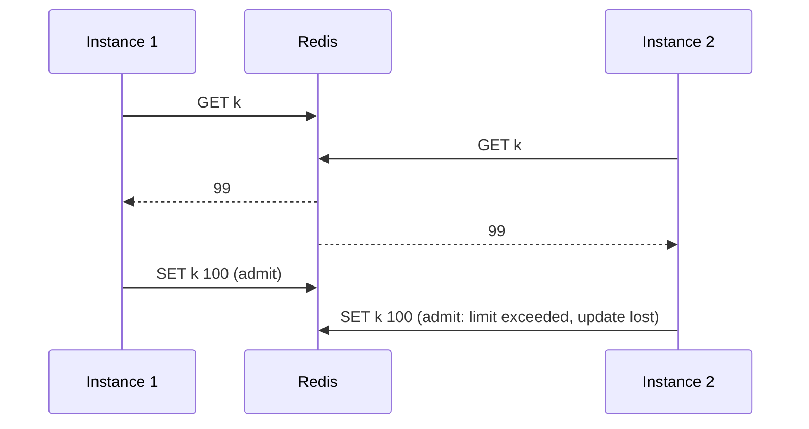

# 09 — Concurrency and Distributed Correctness

> Status: **verified at algorithm level (2A) and over real HTTP across three application instances (2C).** The load-balanced Docker Compose deployment is verified when the full stack is built.

## Invariants
1. Redis is the only authoritative rate-limit state. Instances hold no counters.
2. Each check is exactly one Lua script on one key, so read-decide-write cannot interleave.
3. All time used by production scripts comes from Redis `TIME`.
4. For limit L and N ≥ L simultaneous requests on one quota, exactly L are admitted: never more (a race), never fewer (a lost update).

## The race that Lua removes

The naive implementation reads, decides in Java and writes:

```
count = GET k            # both requests read 99
if count < 100:          # both pass
    SET k count + 1      # both write 100 → 101 requests admitted, counter says 100
```



`ConcurrentAcquisitionIT.negativeControlUnsafeGetThenSetCounterOverAdmits` runs exactly this pattern with the same harness as the real tests. Measured: **1,000 of 1,000 requests admitted against a limit of 100**. Lettuce sends all 1,000 GETs before any SET lands, so every request reads 0. This shows the harness generates real contention, so the passing results below mean something.

## Why Lua scripts are atomic
Redis executes commands on a single main thread, and a script runs to completion before any other command starts. HMGET, the arithmetic, and HSET/HINCRBY/PEXPIRE in one script are therefore one indivisible step. Two instances racing on the same key are simply ordered by Redis.

What this does **not** give: rollback. If a script errors halfway, earlier writes stay. The scripts validate nothing that can fail after the first write, and arguments are validated in Java (`RateLimitRule`) before the call.

Alternatives considered:
| Approach | Problem |
|---|---|
| `GET` + `SET` | Race (above) |
| `INCR` + `EXPIRE` as separate commands | Fixed window only; a crash between them leaves a key with no TTL; no refill logic possible |
| `WATCH`/`MULTI`/`EXEC` (optimistic) | Retries under contention, which is exactly when a limiter is busiest; several round trips |
| Distributed lock (e.g. Redlock) | Extra round trips, lock expiry hazards, much slower |
| **Lua script** | One round trip, atomic, works for all three algorithms |

## Missing-key initialization
A missing key is treated as fresh state *inside* the script (full bucket / zero counts), and the first allowed request writes it in the same atomic step. There is no separate "create if absent" call, so two first requests can't both initialize.

## Shared state and time across instances
- **State:** every instance computes the same key for the same (policy, subject) and talks to the same Redis primary.
- **Time:** scripts read `TIME` on the Redis server, so instance clock skew has no effect. If the Redis clock itself moves backwards (e.g. NTP step), scripts never create tokens or reopen an earlier window (tested for all three algorithms).
- **Test clock:** `ManualScriptClock` passes a fixed `now` to the script and exists only in test sources. `RateLimitAlgorithmConfiguration` hard-wires `RedisServerClock.INSTANCE`.

## Test methodology

| Test | What it proves |
|---|---|
| `ConcurrentAcquisitionIT.exactlyTheLimitIsAdmittedUnderContention` (×3 algorithms) | 1,000 threads released together by a start latch, limit 100 → exactly 100, repeated 5 rounds per algorithm; final Redis state consistent (fixed/sliding `c = 100`; bucket < 1 token left) |
| `…tokenBucketWithRedisServerTimeAdmitsExactlyCapacity` | Same, using Redis `TIME` (refill 1/24 h is negligible) |
| `…threeIndependentClientsShareOneQuota` (×3) | Three separate Lettuce connection factories, as three instances would have, split 1,000 requests round-robin → aggregate exactly 100 |
| `…negativeControlUnsafeGetThenSetCounterOverAdmits` | The harness detects non-atomic code (1,000/1,000 admitted) |
| `ScriptDifferentialIT` (×3 algorithms × 3 seeds) | 3,000 random steps per run: bursts, gaps, window jumps, clock moving back; Lua must equal an independent Java model on every field. Mutation check: two deliberately planted bugs were each caught by all three seeds |

Fixed and sliding window concurrency tests use a frozen clock so a real window boundary can't fall inside the test and make a correct result look wrong. Atomicity, not time, is what they test.

### Results (2026-11-10, Apple M4, Redis 7.4 in Docker)
| Algorithm | Rounds | Requests/round | Admitted every round |
|---|---|---|---|
| Token bucket (test clock) | 5 | 1,000 | 100 |
| Token bucket (Redis TIME) | 5 | 1,000 | 100 |
| Fixed window | 5 | 1,000 | 100 |
| Sliding window | 5 | 1,000 | 100 |
| Each algorithm, 3 clients | 1 | 1,000 | 100 |
| Unsafe GET-then-SET (control) | 1 | 1,000 | 1,000 |

## Guarantees and non-guarantees
| Guaranteed (single Redis primary) | Not guaranteed |
|---|---|
| No over-admission from concurrent requests, on any number of instances | During Redis failover, async replication can lose recent counts → brief over-admission |
| No lost updates | A Redis restart (persistence off) resets all quotas |
| Instance clock skew has no effect | Fail-open (Phase 5) does not enforce limits during a Redis outage |
| Keys never expire while their state matters (+1 s grace) | Sliding-window counter is an approximation (see 05) |

## Distributed correctness over HTTP (2C)

`DistributedHttpRateLimitIT` starts **three full application instances** (each with its own Tomcat,
Spring Security chain, policy cache, Hikari pool and Lettuce connection) against one MySQL and one
Redis container. A dedicated FREE-tier policy (quota 50, refill negligible) is created through
instance 1's API and switched between algorithms through instance 2's API, propagating by pub/sub.
For each algorithm, 300 requests with **one user's token** are fired by 60 client threads released
together, round-robin across the three instances' ports (100 each). No load balancer: every request
goes straight to an instance.

Results (`./mvnw clean verify`, 2026-11-10, Apple M4, Docker Desktop):

| Algorithm | Requests | HTTP 200 (app-1 / app-2 / app-3) | HTTP 429 | Other statuses |
|---|---|---|---|---|
| Token bucket | 300 | **50** (17 / 17 / 16) | 250 | 0 |
| Fixed window | 300 | **50** (17 / 17 / 16) | 250 | 0 |
| Sliding window | 300 | **50** (21 / 18 / 11) | 250 | 0 |
| Anonymous, per-IP policy (10/min) | 300 | **10** (5 / 1 / 4) | 290 | 0 |

The accepted total equals the quota exactly in every case, though no instance knows how many the
others accepted: the only shared state is the Redis key, updated atomically by one script per request.
The per-instance split differs from run to run (it depends on which requests reach Redis first); the
total does not.

## Timeouts do not cancel Redis commands

Found while verifying fail-open behaviour against a paused Redis: the filter gives up after the 50 ms
command timeout, but the `EVALSHA` already sent stays in the TCP buffer and **executes when Redis
resumes**. So a request that was served fail-open, or refused with 503 under fail-closed, can still
consume quota afterwards. Consequences:
- After an outage, clients may see slightly less remaining quota than the requests they actually got served.
- This never causes **over**-admission. A late execution can only use up quota, never grant extra.
- Avoiding it would need command cancellation, which Redis does not offer for a script already
  sent. It is documented rather than fixed.

## Circuit breaker under concurrency (2D)

| Property | Evidence |
|---|---|
| Exactly 3 probes per half-open cycle | Unit: 100 threads released together → delegate called 3 times, 97 refused. HTTP: 50 concurrent requests with probes in flight → Redis `EVALSHA` count rose by exactly 3 |
| A failing probe can never be outvoted | Unit: 50 rounds of 3 concurrent probes (one failing; failing probe varied; finishing first or last) → always OPEN, never CLOSED |
| Bounded Redis calls in a failure storm | Unit: 1,000 requests on 50 threads against a failing Redis → ≤ 60 calls reached it, ≥ 940 refused |
| No Redis calls while OPEN | HTTP: Redis `INFO commandstats` unchanged across 1,000 in-process and 220 HTTP requests (test), and across 50 requests (manual Compose) |
| Independent instances | 3 instances: app-1 closed after probing while app-2/app-3 stayed OPEN; after all recovered, 300 concurrent requests → exactly 50 accepted |

Breakers are per instance and need no coordination: Redis itself is the shared resource, and each
instance's breaker reflects what that instance observes.

## Still to verify
- Behind Nginx in the full Docker Compose deployment, and with k6 load across the instances.
