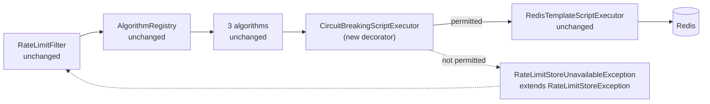
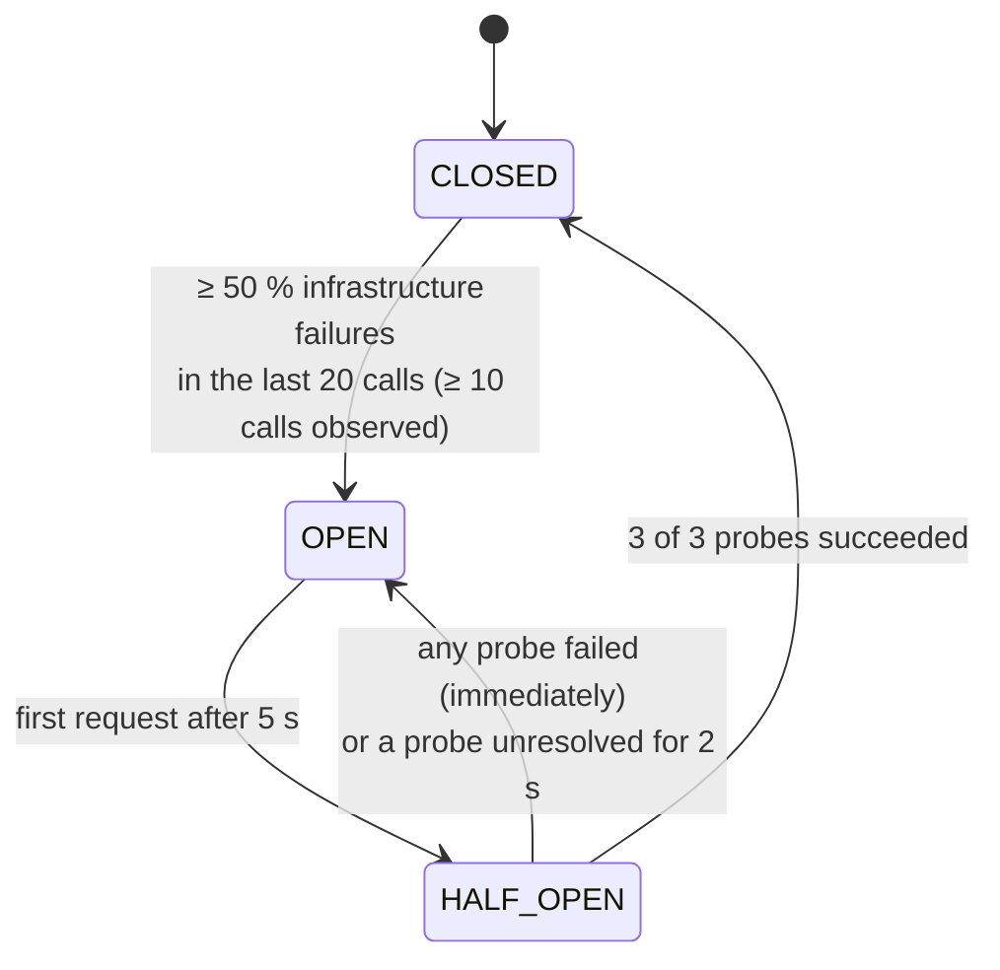

# 2D — Redis Circuit Breaker: Design and Acceptance Criteria

> Status: **IMPLEMENTED, verified and approved (Phase 2, 2026-11-10).** Design approved (D1, R1–R5, R5 = option B). Implementation notes and measured results: §17. One correction to the original §7 text is marked there.
> Phase 2 (Core Backend & Distributed Logic), workstream 2D. Also closes the remaining Phase 2 failure-handling items: Redis connection-pool exhaustion, and readiness behaviour during outages.

| Amendment from review | Where |
|---|---|
| A1 Three successful probes are required to close | §6.1 |
| A2 Behaviour when fewer than three probes arrive within 2 s | §6.3 (decision R5) |
| A3 Fail-open / fail-closed for requests denied permission (OPEN, HALF_OPEN) | §8 |
| A4 Only real Redis infrastructure failures count | §4.2 |
| A5 Micrometer integration decided | §10 |
| A6 Tests: concurrent half-open, NOSCRIPT after restart, pool exhaustion, all failure-mode combinations | §12 |
| A7 Phase 1 readiness documentation and tests updated for R1 | §9.1 |

---

## 1. Problem (measured in 2C)

`FailureModeIT` paused Redis under traffic. Every rate-limited request still sent its script and waited for the **50 ms command timeout** before its failure mode applied: **55–58 ms per request**, for the whole outage.

| Effect | Why it matters |
|---|---|
| +50 ms on every covered request during an outage | Breaks the latency targets exactly when the system is already degraded |
| Tomcat threads held for ~55 ms each | 200 threads ÷ 0.055 s ≈ **3,600 req/s ceiling per instance**, from Redis waits alone; above that, requests queue |
| Redis is hammered while it is struggling | Every request still writes into the TCP buffer of a slow or recovering Redis, and those commands run late (docs/09, "Timeouts do not cancel Redis commands") |
| Thousands of identical timeouts | Noise in logs and metrics, without new information |

---

## 2. Decision D1 (approved): Resilience4j 2.4.0, used programmatically

- Modules `resilience4j-circuitbreaker` and `resilience4j-micrometer`, version **2.4.0** (latest on Maven Central at the time of writing; not managed by the Spring Boot BOM, so pinned in `pom.xml`).
- Not the `resilience4j-spring-boot3` starter or annotations: no AOP proxy on the hot path, and configuration comes from our own validated `ratelimiter.circuit-breaker.*` properties.
- The library owns the lock-free state machine. The project owns the semantics: what counts as a failure (§4.2), the probe rule (§6) and the failure modes (§8).

---

## 3. Placement: the script executor is the breaker boundary



- A decorator implementing the existing `RateLimitScriptExecutor` interface, wrapped around `RedisTemplateScriptExecutor` in `RateLimitAlgorithmConfiguration`.
- **Unchanged:** Lua scripts, algorithms, `AlgorithmRegistry`, policy semantics, and the filter's architecture and decision logic. The filter already turns any `RateLimitStoreException` into the policy's failure mode.
- **One breaker per instance**, named `redis-rate-limit`. Redis is a single endpoint, so its health is not per key or per policy. The three instances' breakers are independent.
- **No retries.** Retrying during an outage multiplies load on a struggling Redis and adds latency. The failure mode is the fallback.
- **Not wrapped:** `RateLimitScriptPreloader` (startup) and the policy pub/sub listener. Neither is on the request path, and neither may influence the breaker.

---

## 4. States and what is recorded

### 4.1 State machine



| State | Calls to Redis | Client gets |
|---|---|---|
| CLOSED | all | normal result (200 + headers, or 429); the failure mode on an individual infrastructure error |
| OPEN | **none** | the failure mode immediately (§8) |
| HALF_OPEN | only the 3 permitted probes | probes: normal result. Everyone else: the failure mode immediately (§8) |

### 4.2 Classification: only Redis infrastructure failures count (A4)

The decorator classifies every outcome **before** reporting it to the breaker:

| Outcome | Examples | Breaker | Request |
|---|---|---|---|
| Script returned | allowed **or rejected** (429) | success | normal |
| **Infrastructure failure** | `QueryTimeoutException` / Lettuce `RedisCommandTimeoutException` (50 ms timeout); `RedisConnectionFailureException`; pool exhaustion (§9.2); `DataAccessResourceFailureException`; Redis error replies that mean the server cannot serve: `OOM`, `BUSY`, `LOADING`, `MASTERDOWN`, `READONLY`, `CLUSTERDOWN`, `TRYAGAIN` | **failure** | failure mode |
| **Programming / contract error** | malformed or inconsistent script reply (wrong arity, `remaining > limit`); Lua runtime error (`ERR Error running script …`); `WRONGTYPE`; argument errors; any non-`DataAccessException` | **ignored**: not counted, cannot open or close the breaker | 2C behaviour unchanged: store errors still map to the failure mode; other exceptions propagate (500) |
| `NOSCRIPT` | script cache empty after a Redis restart or `SCRIPT FLUSH` | not seen by the breaker: Spring Data Redis retries with `EVAL` inside the same executor call, and only the final outcome is classified | normal (one extra round trip) |
| Not permitted | OPEN, or HALF_OPEN with no permit left | not recorded (Redis was not called) | failure mode immediately |

Implementation rule: classification is an **allow-list** of infrastructure causes found in the exception's cause chain (exception types, plus Redis error-reply prefixes for server errors). Anything not on the list is ignored. A new, unknown exception type can therefore never open the breaker by accident; the worst case is a missed failure, which the 50 ms timeout still bounds.

Slow-call detection stays **off**: the 50 ms command timeout already turns slow calls into failures.

---

## 5. Configuration (approved values, R2)

| Property `ratelimiter.circuit-breaker.*` | Default | Meaning |
|---|---|---|
| `enabled` | `true` | `false` = 2C behaviour (every call waits for the timeout) |
| `sliding-window-size` | `20` | Count-based window of the last 20 recorded calls |
| `minimum-number-of-calls` | `10` | Never evaluate (never open) on fewer than 10 recorded calls |
| `failure-rate-threshold` | `50` | Percent of infrastructure failures in the window that opens the breaker |
| `wait-duration-in-open-state` | `5s` | OPEN time before the next request starts probing |
| `permitted-calls-in-half-open` | `3` | Probes per half-open cycle; **all must succeed** to close |
| `max-wait-in-half-open` | `2s` | Probe timeout (semantics in §6.3, decision R5) |

Startup validation: threshold 1–100; sizes ≥ 1; `minimum-number-of-calls ≤ sliding-window-size`; durations > 0. The fail-closed `Retry-After` stays `ratelimiter.filter.fail-closed-retry-after` = **5 s** (R3).

---

## 6. Half-open probing (R4: real requests)

### 6.1 Three successful probes are required to close (A1)

**Resilience4j's own rule is not enough.** After the permitted calls complete, the library re-applies the *same* `failure-rate-threshold` (50 %): 2 successes + 1 failure = 33 % < 50 %, so it would **close**. To guarantee "3 of 3":

1. When a probe (a call admitted while the state was HALF_OPEN) ends in an **infrastructure failure**, the decorator calls `transitionToOpenState()` **before** reporting the failure to the breaker. The library therefore never sees three completed probes containing a failure, so it cannot close on a partial success.
2. The library closes only after all 3 permitted probes have reported success.
3. A probe that ends in an *ignored* (programming) error releases its permit (`releasePermission`) and counts as neither success nor failure. The breaker stays HALF_OPEN until 3 genuine successes are reported.

Resulting rule: **HALF_OPEN → CLOSED requires exactly three successful probes and zero infrastructure failures in that half-open cycle. Any failed probe → OPEN at once, and a new 5 s wait starts.**

### 6.2 Permits under concurrency
- OPEN → HALF_OPEN is lazy: the first request after 5 s performs the transition with a compare-and-set and becomes probe 1. No timer thread is needed.
- Permits are taken atomically by the library. With 100 requests arriving together, exactly 3 reach Redis; the other 97 get the failure mode immediately (§8).
- Probes are ordinary user requests: allowed or rejected (429) like any other. A 429 from a probe is a **success** (Redis answered).

### 6.3 Fewer than three probes within 2 seconds (A2): decision R5

Taken literally, Resilience4j's `maxWaitDurationInHalfOpenState = 2s` means: if 3 probes have not *completed* within 2 s, go back to OPEN.

| | **Option A: library semantics** | **Option B (recommended): 2 s bounds unresolved probes** |
|---|---|---|
| Rule | 2 s after entering HALF_OPEN, if fewer than 3 probes completed → OPEN, new 5 s wait | HALF_OPEN waits until 3 probes have **arrived**; earned successes are kept. → OPEN only if a probe is **admitted but unresolved** for 2 s, or any probe fails |
| Low-traffic instance (< 3 requests per 2 s) | **Never closes while Redis is healthy.** Every cycle gets 1–2 successful probes, then times out and reopens. Fail-closed endpoints keep answering 503 and fail-open endpoints stay unlimited, indefinitely | Closes after 3 successful requests, however far apart |
| High-traffic instance | Closes within milliseconds | Closes within milliseconds (identical) |
| Hung probe (driver bug, hung connection) | Reopens after 2 s | Reopens after 2 s (identical) |
| Implementation | Library setting only | Library `maxWaitDurationInHalfOpenState = 0` (wait for all permits), plus a lock-free watchdog in the decorator: an atomic count of in-flight probes and the start time of the oldest. Every not-permitted request in HALF_OPEN checks it and, if a probe has been unresolved for > 2 s, calls `transitionToOpenState()`. Permits are always released in `finally`, so none can leak |

Probes cannot normally take longer than the 50 ms command timeout. In Option B the 2 s guard therefore only fires on a genuine hang, which is its intent. Option A's guard instead fires whenever traffic is quiet, which is not.

**Recommendation: Option B.** It keeps the approved 2 s value and the "3 successes" rule, and removes the low-traffic livelock. Your decision is needed (R5). The tests in §12 are written for the chosen option.

---

## 7. Thread safety and concurrent behaviour

| Scenario | Behaviour |
|---|---|
| State transitions | Resilience4j holds the state in an `AtomicReference` and transitions with compare-and-set. Exactly one thread wins each transition; no locks on the request path. Our forced transitions use the same API |
| Failure storm in CLOSED (200 requests in flight when Redis stops) | Requests already sent still wait ≤ 50 ms. Once ≥ 10 recorded calls show ≥ 50 % failures, the breaker opens and later requests return in microseconds. Redis calls during the storm are bounded by about (requests in flight at the moment it opens) + `minimum-number-of-calls`; measured in tests |
| Late results | *(Corrected during implementation: Resilience4j records a result into the **current** state, not the state that admitted the call.)* The decorator therefore never records a result older than the 2 s probe timeout, and startup validation requires the open wait (5 s) to exceed it. Every recorded result therefore lands in the half-open cycle that admitted it, or in OPEN, where it changes nothing. A stale success can never help close a later cycle |
| Concurrent probes | Exactly 3 permits per half-open cycle (asserted). A failing probe forces OPEN with CAS; a concurrent successful probe completing afterwards cannot close an OPEN breaker |
| Permit accounting | Every admitted call ends in exactly one of: success, failure, or release (ignored error), in a `finally` block. Watchdog counters are atomics |
| Multiple instances | Independent breakers; each opens from its own observations. The shared resource is Redis itself, so no coordination is needed |

---

## 8. Fail-open / fail-closed for every breaker situation (A3)

The breaker only decides **whether Redis is called**. A refused call surfaces as `RateLimitStoreUnavailableException`, a subclass of the existing `RateLimitStoreException`, so the filter applies the **unchanged** 2C rule:
- effective mode = the policy's `failureMode`, else `ratelimiter.default-failure-mode`;
- FAIL_OPEN → the request continues **without** `X-RateLimit-*` headers;
- FAIL_CLOSED → **503**, `Retry-After: 5`, the standard JSON body, and **never 429**.

| Breaker situation | Redis called | FAIL_OPEN (policy or default) | FAIL_CLOSED (policy or default) | Added latency |
|---|---|---|---|---|
| CLOSED, Redis healthy | yes | 200 + headers / 429 | 200 + headers / 429 | normal |
| CLOSED, infrastructure error | yes | 200, no headers | 503 + Retry-After 5 | ≤ 50 ms |
| CLOSED, programming error in a store call | yes | 200, no headers (2C behaviour) | 503 (2C behaviour) | normal |
| **OPEN (permission denied)** | **no** | **200, no headers** | **503 + Retry-After 5** | **~0 ms** |
| HALF_OPEN, permitted probe, success | yes | 200 + headers / 429 | 200 + headers / 429 | normal |
| HALF_OPEN, permitted probe, infrastructure failure (→ OPEN) | yes | 200, no headers | 503 + Retry-After 5 | ≤ 50 ms |
| **HALF_OPEN, permission denied** | **no** | **200, no headers** | **503 + Retry-After 5** | **~0 ms** |

- The breaker never produces a 429 and never turns a 429 into anything else.
- A per-policy override wins in both directions: a FAIL_CLOSED policy under a FAIL_OPEN default answers 503, and vice versa.
- Denied requests are counted in metrics (`not_permitted`, `ratelimiter_redis_errors_total{type="circuit_open"}`) and covered by the filter's existing 10-second log throttle.

---

## 9. Remaining Phase 2 failure-handling items folded into 2D

### 9.1 Readiness (R1, approved) — Phase 1 documentation and tests updated (A7)

**Rule:** readiness = the application is initialised **and** a usable policy snapshot is loaded (from the database, or from development fallbacks). Redis and MySQL availability do **not** gate traffic. They remain independently visible.

| Endpoint | Contents | Used by |
|---|---|---|
| `/actuator/health/readiness` | `readinessState`, `policies` | load balancer / orchestrator |
| `/actuator/health/liveness` | `livenessState` (unchanged) | restart decisions |
| `/actuator/health/dependencies` (new group) | `db`, `redis`, `rateLimitStore` (circuit breaker) | dashboards, alerts, humans |
| `/actuator/health` | everything | humans (details in `dev` only) |

| Situation | Readiness before R1 | Readiness after R1 |
|---|---|---|
| Startup, no policies yet (prod, MySQL down) | 503 | **503** (unchanged) |
| Startup, dev fallback policies, MySQL down | 503 (db DOWN) | **200** (fallback policies are usable) |
| Redis outage at runtime | 503 on every instance → total outage | **200**; failure modes and breaker apply |
| MySQL outage at runtime | 503 on every instance → total outage | **200**; last good snapshot serves |

Phase 3 note: Docker Compose health checks and the Nginx upstream configuration must use **readiness**, not `/actuator/health` (which goes DOWN with any dependency).

Changes required by R1 (part of the 2D implementation):

| Artifact | Change |
|---|---|
| `application.yml` | readiness group → `readinessState,policies`; new group `dependencies` → `db,redis,rateLimitStore` |
| `InfrastructureIT.readinessProbeIsUpWhenRedisAndMysqlAreUp` | Rename and rewrite: readiness contains `policies` and not `db`/`redis`; the new `dependencies` group contains `db`, `redis`, `rateLimitStore` |
| `StartupWithoutMySqlIT` (dev fallback case, currently expects 503) | Expect **200**, plus `dependencies` → 503 with `db` DOWN |
| `StartupWithoutMySqlIT` (prod case) | Unchanged: 503 until policies load |
| New IT (§12) | Redis paused → readiness 200, `dependencies` 503; MySQL stopped at runtime → readiness 200 |
| docs/02 | Reliability requirement rewritten to the R1 rule |
| docs/04 | New decision D33 (supersedes the Phase 1 readiness group) |
| docs/07, docs/14 | Health tables updated; how to check dependencies |
| docs/13 | Phase 1 rows "Redis stopped → readiness 503" marked *superseded by R1*, with the new verified behaviour |
| docs/10, `PROJECT_PROGRESS.md` | Phase 1 manual evidence annotated *superseded by R1* (historical record kept) |

### 9.2 Connection-pool exhaustion (pool mode)
With `REDIS_POOL_ENABLED=true` and a small pool, a request that cannot borrow a connection within `max-wait` (20 ms) must:
1. surface as a `RateLimitStoreException`. Spring Data Redis wraps the pool failure in `PoolException`; its type and cause chain are verified at implementation, and the executor's catch is widened if it is not a `DataAccessException`;
2. be classified as an **infrastructure** failure (`type="pool"`);
3. follow the failure mode, and open the breaker if sustained.

---

## 10. Observability (A5): Micrometer integration decided

**Decision:** use **`resilience4j-micrometer` 2.4.0** (`TaggedCircuitBreakerMetrics`) for the standard breaker meters, and implement the two project-specific meters with **Resilience4j event listeners** and the decorator.

- **Compatibility:** `resilience4j-micrometer` declares `micrometer-core`. The Spring Boot 3.5 BOM manages Micrometer, so Maven resolves the BOM's version. The first implementation step confirms this with `mvn dependency:tree` and a test asserting that the meters exist.
- **Fallback, if the binding is not compatible:** drop the module and register the same meter names from the breaker's event publisher (`onStateTransition`, `onError`, `onSuccess`, `onCallNotPermitted`) and a gauge on `getState()`. The meter names and tags in the table below do not change either way.

| Meter | Type | Tags (bounded) | Source |
|---|---|---|---|
| `resilience4j_circuitbreaker_state` | gauge | `name`, `state` | binding |
| `resilience4j_circuitbreaker_calls_seconds` | timer | `name`, `kind` = successful / failed / ignored | binding |
| `resilience4j_circuitbreaker_not_permitted_calls_total` | counter | `name` | binding |
| `resilience4j_circuitbreaker_failure_rate` | gauge | `name` | binding |
| `ratelimiter_circuit_breaker_transitions_total` | counter | `from`, `to` | event listener (incl. forced transitions) |
| `ratelimiter_redis_errors_total` | counter | `type` = timeout / connection / pool / server / circuit_open | decorator (only infrastructure errors and denials; ignored programming errors use `ratelimiter_redis_ignored_errors_total`) |

- Meters are registered in the application `MeterRegistry` now and asserted in tests. `/actuator/prometheus` exposure and Grafana panels are Phase 3.
- Logs: WARN on → OPEN (failure rate, last error), INFO on → HALF_OPEN and → CLOSED.
- Health contributor `rateLimitStore`: UP when CLOSED; `OUT_OF_SERVICE` when OPEN or HALF_OPEN. Details: state, failure rate, not-permitted count. Part of the `dependencies` group only (R1).

---

## 11. Recovery timeline (defaults, Option B)

```
t=0.000      Redis stops responding
t=0–0.050    in-flight requests time out (≤ 50 ms each); failures accumulate
t≈0.05       ≥ 10 recorded calls, ≥ 50 % failed → CLOSED→OPEN (WARN, metric)
t≈0.05–5.05  every request: failure mode in ~0 ms; Redis not called
t=2.0        Redis recovers (nobody calls it yet)
t=5.05       next request → OPEN→HALF_OPEN; it is probe 1
             probes 2 and 3 are the next two requests (milliseconds later under load)
t≈5.06       3/3 succeeded → HALF_OPEN→CLOSED (INFO); limiting with headers resumes
```

Worst case from Redis recovering to limits being enforced again: 5 s, plus the time for three requests to arrive. Requests in that gap get their failure mode, which is the price of not hammering a recovering Redis.

---

## 12. Test plan (A6 additions marked ★)

### Unit: `CircuitBreakingScriptExecutorTest` (mocked delegate; deterministic time through Resilience4j's configurable clock if 2.4.0 exposes one, otherwise short waits with Awaitility)
1. Stays CLOSED below 10 recorded calls, even if all failed.
2. Opens at ≥ 50 % infrastructure failures over the window; transition metric recorded.
3. OPEN: throws `RateLimitStoreUnavailableException` **without calling the delegate**.
4. Rejected results (`allowed = 0`, i.e. 429) are successes and never open the breaker.
5. ★ **Classification table (§4.2):** each infrastructure cause counts as a failure; each programming error is ignored, i.e. 100 consecutive programming errors leave the breaker CLOSED with failure rate 0.
6. After 5 s the first call → HALF_OPEN and is executed (probe 1).
7. ★ **3 of 3 probes succeed → CLOSED;** 2 successes are not enough.
8. ★ **Any probe failure → OPEN immediately**, including when it is the 3rd probe after two successes (the case where the library alone would close).
9. ★ Probe with an ignored programming error: permit released, still HALF_OPEN, closes only after 3 genuine successes.
10. ★ **Fewer than 3 probes within 2 s** (per R5): Option B: 1 probe, then 3 s silence, then 2 more → CLOSED. Option A: → OPEN after 2 s.
11. ★ Unresolved probe > 2 s (delegate blocks) → OPEN via the guard.
12. ★ **Concurrent half-open:** 100 threads released together → the delegate is called exactly 3 times, and 97 receive `RateLimitStoreUnavailableException` immediately.
13. ★ **Concurrent half-open with one failing probe** among 3 concurrent probes → ends OPEN, never CLOSED (repeated 50 times to expose races).
14. Failure storm: 1,000 threads, failing delegate → ends OPEN; delegate calls bounded (asserted).
15. Metrics: `ratelimiter_redis_errors_total{type}` for timeout / connection / pool / server / circuit_open; transitions counter; binding meters present.
16. Disabled breaker → pure pass-through.
17. Property validation rejects inconsistent settings.

### Unit: `RateLimitFilterTest` additions
18. ★ **All failure-mode combinations (parameterised):** {CLOSED + infrastructure error, OPEN denied, HALF_OPEN denied, HALF_OPEN probe failure} × {policy FAIL_OPEN, policy FAIL_CLOSED, no override + default FAIL_OPEN, no override + default FAIL_CLOSED} = 16 cases. Asserts status (200 / 503, never 429), `Retry-After: 5` on every 503, no `X-RateLimit-*` when the store was not consulted successfully, and whether the controller was reached.

### Integration: `CircuitBreakerIT` (real application instances, real Redis container)
19. **Latency drop:** Redis paused; once OPEN, the in-process limiter decision is < 5 ms at P99 over ≥ 200 requests (vs ~55 ms in 2C).
20. **No Redis traffic while OPEN:** Redis `INFO commandstats` `cmdstat_evalsha` calls do not increase between two samples taken while OPEN. Redis is unpaused only for sampling, then re-paused while the breaker is still within its 5 s OPEN window.
21. ★ **Failure-mode combinations over HTTP** while OPEN: `/public` (FAIL_OPEN via default) → 200 without headers; `/enterprise` (FAIL_CLOSED policy) → 503 + `Retry-After: 5`; instance with default FAIL_CLOSED → `/public` 503; never 429.
22. **Recovery:** unpause → OPEN → HALF_OPEN → CLOSED within 5 s + 1 s; responses carry `X-RateLimit-*` again; the transition counters show exactly this sequence.
23. **Flapping:** pause again while HALF_OPEN → OPEN, and the 5 s wait restarts.
24. ★ **Concurrent half-open over HTTP:** after the wait, 50 simultaneous requests → exactly 3 reach Redis (`cmdstat_evalsha` delta = 3), the others get their failure mode, and the breaker CLOSES.
25. ★ **Script-cache loss (NOSCRIPT) after restart:** while traffic flows, `SCRIPT FLUSH` (and separately `FLUSHALL` + `SCRIPT FLUSH`, which is what a restart without persistence leaves). The next requests succeed through the `NOSCRIPT → EVAL` fallback, the breaker stays CLOSED with failure rate 0, and quotas restart from full (documented consequence of a Redis restart).
26. ★ **Pool exhaustion:** pool enabled, `max-active=1`, Redis paused, concurrent requests → borrow timeouts classified `type="pool"`, breaker opens, failure modes apply; after unpause, recovery as in 22.
27. **Three instances:** each instance's breaker opens and recovers independently; after recovery, aggregate accepted requests from one identity across the three still equal the quota exactly (2C harness).
28. ★ **Readiness (R1):** Redis paused → readiness 200, `dependencies` 503 (`redis` DOWN, `rateLimitStore` OUT_OF_SERVICE); MySQL stopped at runtime → readiness 200, `db` DOWN; prod startup without policies → readiness 503 (unchanged).

### Updated existing tests (R1, A7)
29. `InfrastructureIT` readiness test rewritten (§9.1).
30. `StartupWithoutMySqlIT` dev-fallback case expects readiness 200; the prod case is unchanged.
31. `FailureModeIT` keeps passing with the breaker enabled. Its latency assertion now distinguishes the first ≤ 10 requests (timeout) from requests after opening (~0 ms).

---

## 13. Acceptance criteria (Phase 2 exit for 2D)

| # | Criterion | Verified by |
|---|---|---|
| AC1 | CLOSED → OPEN only on ≥ 50 % **infrastructure** failures over the last 20 calls, with ≥ 10 recorded | unit 1–2, 5; IT 22 |
| AC2 | Programming errors never contribute to the failure rate | unit 5, 9 |
| AC3 | OPEN never calls Redis; limiter decision P99 < 5 ms during an outage | unit 3; IT 19, 20 |
| AC4 | OPEN → HALF_OPEN after 5 s; exactly 3 probes reach Redis under concurrency | unit 6, 12; IT 24 |
| AC5 | HALF_OPEN → CLOSED only after **3 of 3** successful probes; any probe failure → OPEN immediately | unit 7, 8, 13 |
| AC6 | Fewer than 3 probes in 2 s handled as decided in R5; an unresolved probe > 2 s → OPEN | unit 10, 11 |
| AC7 | All 16 breaker × failure-mode combinations behave per §8; never 429; `Retry-After: 5` on every fail-closed 503 | unit 18; IT 21 |
| AC8 | Automatic recovery when Redis returns, with no restart; headers resume | IT 22, 23 |
| AC9 | NOSCRIPT after script-cache loss does not trip the breaker | IT 25 |
| AC10 | Pool exhaustion classified as an infrastructure failure and handled by the failure mode | unit 15; IT 26 |
| AC11 | Transition and failure metrics recorded with bounded tags; Micrometer binding (or the documented fallback) verified | unit 15; IT 22 |
| AC12 | Readiness per R1; dependency health visible in the `dependencies` group; Phase 1 docs and tests updated | IT 28; tests 29–30; doc review |
| AC13 | Distributed quota still exact across 3 instances after an outage and recovery | IT 27 |
| AC14 | Lua scripts, algorithms, policy semantics and filter architecture unchanged (diff review) | review |
| AC15 | `./mvnw clean verify` green; docs 02, 04, 06, 07, 09, 10, 13, 14 and `PROJECT_PROGRESS.md` updated | build + review |

---

## 14. Files (planned)

| New | Purpose |
|---|---|
| `redis/CircuitBreakingScriptExecutor.java` | Decorator: permission, classification, 3-of-3 probe rule, unresolved-probe guard, error metrics |
| `redis/RateLimitStoreUnavailableException.java` | "Not permitted" signal (subclass of `RateLimitStoreException`) |
| `redis/RedisFailureClassifier.java` | Allow-list classification (§4.2), unit-testable on its own |
| `resilience/CircuitBreakerProperties.java` | Validated `ratelimiter.circuit-breaker.*` |
| `resilience/CircuitBreakerConfiguration.java` | Breaker, Micrometer binding, transition listener, health contributor |
| `resilience/RateLimitStoreHealthIndicator.java` | `rateLimitStore` health (dependencies group) |
| Tests | `CircuitBreakingScriptExecutorTest`, `RedisFailureClassifierTest`, `CircuitBreakerIT`, filter test additions |

| Modified | Change |
|---|---|
| `pom.xml` | `resilience4j-circuitbreaker`, `resilience4j-micrometer` 2.4.0 |
| `RateLimitAlgorithmConfiguration` | Wrap the executor in the decorator (single line of wiring) |
| `application.yml` | `ratelimiter.circuit-breaker.*` defaults; readiness and `dependencies` groups (R1) |
| `RateLimitFilterTest` | Failure-mode matrix |
| `InfrastructureIT`, `StartupWithoutMySqlIT`, `FailureModeIT` | R1 and breaker expectations (§12, 29–31) |
| Docs | 02, 04 (D33–D35), 06, 07, 09, 10, 13, 14, `PROJECT_PROGRESS.md` |

**Not modified:** `scripts/*.lua`, `algorithm/*`, `AlgorithmRegistry`, policy package, security / JWT / identity, and `RateLimitFilter`'s logic. The filter already handles `RateLimitStoreException`; if a change there proves necessary, it will be called out for review.

---

## 15. Out of scope for 2D
- Per-key or per-policy breakers.
- Redis Sentinel / Cluster failover (documented in Phase 4).
- Local fallback limiter during outages (limit ÷ N per instance): advanced item.
- Prometheus exposure and Grafana panels for these meters (Phase 3).

---

## 16. Decisions

| # | Decision | Status |
|---|---|---|
| D1 | Resilience4j 2.4.0 core modules, programmatic | ✅ Approved |
| R1 | Readiness = initialisation + usable policies; dependency health visible separately | ✅ Approved (implementation detail in §9.1) |
| R2 | Window 20, minimum 10, 50 %, OPEN 5 s, 3 half-open permits, 2 s half-open maximum | ✅ Approved |
| R3 | Fixed `Retry-After: 5` on fail-closed 503 | ✅ Approved |
| R4 | Real requests as half-open probes | ✅ Approved |
| A5 | Micrometer: `resilience4j-micrometer` binding + event listeners for project meters; listener-only fallback if incompatible | Resolved in this revision |
| R5 | The 2 s half-open maximum bounds one in-flight probe; quiet traffic does not reopen (Option B) | ✅ Approved and implemented |

---

## 17. Implementation notes and verified results (2026-11-10)

### Findings during implementation
| Finding | Consequence / fix |
|---|---|
| `resilience4j-micrometer` 2.4.0 was compiled against Micrometer **1.16.0**; the Spring Boot 3.5 BOM resolves **1.15.12** | Verified working: binding registers every meter with no linkage errors (unit test `infrastructureErrorsAreCountedByType` reads them). Listener-only fallback not needed. The module's four unrelated runtime dependencies (bulkhead, retry, ratelimiter, timelimiter) are excluded |
| Resilience4j records late results into the *current* state (§7 corrected) | Results older than the 2 s probe timeout are never recorded; `wait-duration-in-open-state > max-wait-in-half-open` is enforced at startup |
| With the library's rule alone, 2 successes + 1 failure (33 %) close the breaker | A failed probe forces OPEN *before* it is reported; tested, and a planted mutation removing this was caught by 3 tests |
| `PoolException` is **not** a `DataAccessException` in Spring Data Redis | Before 2D, pool exhaustion would have escaped the executor as an HTTP 500. `RedisTemplateScriptExecutor` now also catches `PoolException` (the executor is the breaker boundary) |
| With `spring.data.redis.lettuce.pool.enabled=true`, Lettuce still sent EVALSHA over its **shared** connection: the pool setting had no effect on rate-limit calls | `RedisPoolingConfiguration` turns the shared connection off when pooling is enabled. Pool exhaustion then occurs and is handled (verified). Default remains pooling OFF |
| Over real HTTP with a healthy Redis, probes finish in ~1 ms, so the breaker closes during a concurrent burst and later requests are served normally | Correct behaviour. The "exactly 3 probes" check over HTTP is done with probes held in flight (Redis paused at half-open), and verified with Redis's own `INFO commandstats` |

### Code delivered
`redis/CircuitBreakingScriptExecutor`, `redis/RedisFailureClassifier`, `redis/RateLimitStoreUnavailableException`, `resilience/CircuitBreakerProperties`, `resilience/CircuitBreakerConfiguration`, `resilience/RateLimitStoreHealthIndicator`, `config/RedisPoolingConfiguration`. Modified: `pom.xml`, `RateLimitAlgorithmConfiguration` (executor wiring), `RedisTemplateScriptExecutor` (catch `PoolException`), `application.yml` (breaker properties; readiness and `dependencies` groups). **Not modified:** Lua scripts, algorithms, `AlgorithmRegistry`, policy package, security/JWT/identity, `RateLimitFilter`.

### Measured (from `./mvnw clean verify` and the manual Compose run; Apple M4, Docker Desktop)
| Measurement | Test run | Manual Compose run |
|---|---|---|
| Requests that paid the 50 ms timeout before OPEN | 9 (after 1 recorded success) at 53–59 ms each | 9 at 55–64 ms each |
| Limiter decision while OPEN, in-process (1,000 calls) | p50 8 µs, p99 19 µs, max 1.2 ms | — |
| HTTP request while OPEN, localhost (200 requests) | p50 0.84 ms, p99 1.6 ms | fail-open 2.7 ms, fail-closed 2.5 ms (single curl) |
| Redis EVALSHA executions while OPEN | 10 before → 10 after | 34 before → 34 after (50 requests sent) |
| OPEN → CLOSED once Redis is healthy | 5.18 s | 5.33 s |
| Concurrent half-open: requests reaching Redis | 3 of 50 | — |
| Pool mode (max-active 1), Redis paused, 40 requests | pool=23, timeout=1, refused=16 → OPEN | — |
| 3 instances | app-1 recovered while app-2/app-3 stayed OPEN; after all recovered: exactly 50/300 accepted | — |
