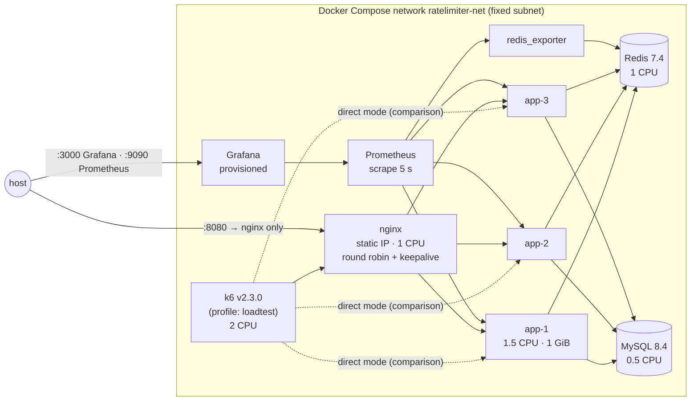
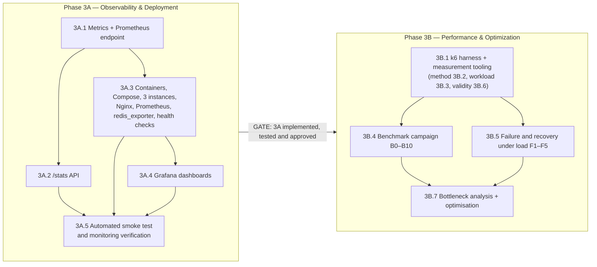

# Phase 3 — Observability, Deployment & Performance: Implementation Plan

> Status: **Plan approved and executed. Phase 3A approved (2026-11-11); Phase 3B completed and approved (2026-11-12).** Results: `docs/11-performance-benchmarks.md`; analysis and acceptance checklist: `benchmarks/reports/phase-3b-final/analysis.md`. The text below is the approved plan; the targets in it are targets, the measured values are in docs/11.
> Every target below is a target. Results appear only after they have been measured and saved under `benchmarks/results/`.
>
> **Structure: exactly two parts.**
> - **Phase 3A — Observability & Deployment**
> - **Phase 3B — Performance & Optimization**
>
> **Gate:** Phase 3A must be fully implemented, tested and approved before any Phase 3B work begins.
> This revision only regroups the earlier seven-workstream plan; no feature, scenario, acceptance criterion or decision was removed (traceability in §6).

---

## 0. Scope (all 16 agreed items preserved)

| # | Scope item | Part |
|---|---|---|
| 1 | Micrometer metrics | 3A |
| 2 | Prometheus integration | 3A |
| 3 | Grafana dashboards | 3A |
| 4 | `/stats` API | 3A |
| 5 | Complete Docker Compose deployment | 3A |
| 6 | Three Spring Boot application instances | 3A |
| 7 | Nginx load balancing | 3A |
| 8 | k6 performance testing | 3B (k6 smoke checks also run in 3A) |
| 9 | Load levels 1,000 → 10,000 RPS | 3B |
| 10 | P50, P95, P99 latency | 3A (instrumentation) · 3B (measurement) |
| 11 | Throughput and error rate | 3B |
| 12 | CPU and memory | 3A (collection) · 3B (measurement) |
| 13 | Redis latency and resources | 3A (exporter, metrics) · 3B (measurement) |
| 14 | Token Bucket / Fixed Window / Sliding Window benchmarking | 3B |
| 15 | Redis pooling enabled vs disabled | 3B |
| 16 | Bottleneck analysis and evidence-based optimisation | 3B |

Constraints kept: Java 17; existing Spring Boot architecture; three instances sharing Redis and MySQL; no Kubernetes; **no change to the Lua algorithms or core rate-limiting behaviour without presenting the reason for review first**; no commits without approval.

---

## 1. Target architecture (built in 3A, measured in 3B)

| Decision in the picture | Why |
|---|---|
| App ports **not** published; only Nginx on :8080 | All client traffic goes through the load balancer, as in production |
| Nginx gets a **static IP**; apps run with `TRUSTED_PROXIES=<that IP>` | Only Nginx's `X-Forwarded-For` is trusted (2B rule, unchanged) |
| Container **health checks use `/actuator/health/readiness`** | Decision R1 (2D): a Redis/MySQL outage must not take instances out of rotation |
| Nginx blocks `/actuator/**` externally; Prometheus scrapes apps on the internal network | Metrics are not exposed to clients |
| k6 runs **inside** the Compose network | Avoids macOS host→VM port forwarding, which would itself be measured. Same-machine limits documented (§3B.6) |
| Per-container CPU and memory limits | Results are reproducible, and saturation is attributable to a component (§3B.6.2) |

Existing behaviour is unchanged: the same three-instance design with shared Redis and MySQL, prod profile, JWT, policies, the filter in the security chain, and the circuit breaker.

---

## 2. The two parts and the gate

| Part | Exit condition |
|---|---|
| **3A** | All 3A acceptance criteria met; `./mvnw clean verify` green (existing 288 tests unchanged + new tests); the smoke script passes from a clean state; docs updated; **your approval**. Only then does 3B start |
| **3B** | All 3B acceptance criteria met; every reported number traceable to `benchmarks/results/`; docs updated; your approval |

Internal order: **3A.1 → (3A.2 ∥ 3A.3) → 3A.4 → 3A.5**, then after the gate **3B.1 → (3B.4 ∥ 3B.5) → 3B.7**, with the method, workload model and validity rules of 3B.2, 3B.3 and 3B.6 applied to every run. Documentation is updated within each part (§7).

---

# PHASE 3A — OBSERVABILITY & DEPLOYMENT

## 3A.1 Micrometer metrics and Prometheus endpoint

### What
- Add `micrometer-registry-prometheus` (BOM-managed) and expose `/actuator/prometheus` (prod and dev).
- A new `RateLimitMetrics` recorder, called **once per rate-limit decision** from `RateLimitFilter`, plus a timing decorator at the existing script-executor boundary.

### Required meters (names from the requirements)

| Prometheus name | Type | Tags (bounded) | Measures |
|---|---|---|---|
| `ratelimiter_requests_total` | counter | `algorithm`, `result` ∈ {allowed, rejected, fail_open, fail_closed} | Every decision |
| `ratelimiter_allowed_total` | counter | `algorithm` | Allowed decisions |
| `ratelimiter_rejected_total` | counter | `algorithm` | 429 decisions |
| `ratelimiter_request_duration_seconds` | histogram | `algorithm`, `result` | **Rate-limiter overhead:** identity + policy lookup + algorithm + Redis round trip + result mapping (timed inside the filter) |
| `ratelimiter_redis_duration_seconds` | histogram | `algorithm`, `outcome` ∈ {success, error} | Redis script round trip only (timed around the delegate executor, inside the breaker; refused calls are not timed) |
| `ratelimiter_redis_errors_total` | counter | `type` | Exists (2D) |
| `ratelimiter_algorithm_executions_total` | counter | `algorithm` | Script executions that reached Redis |

Also already available or added by configuration: the circuit-breaker meters (2D), `http_server_requests_seconds` (Spring MVC), JVM (heap, GC pauses, threads), `process_cpu_usage`, Tomcat, Hikari, and Lettuce command latency (Micrometer's Lettuce integration, if the Boot version enables it; checked during implementation).

- **Common tags:** `application`; `instance` comes from the Prometheus target. **Never** user id, IP, path or policy name.
- **Histograms:** `publishPercentileHistogram=true` with `minimumExpectedValue=50µs` and `maximumExpectedValue=1s`. Decisions take well under a millisecond, and Micrometer's defaults would put them all in one or two buckets. P50/P95/P99 across instances are computed in Prometheus with `histogram_quantile` over summed buckets, **never** by averaging per-instance percentiles. Client-side percentile publishing stays off, because those values cannot be aggregated.

### Change to existing code: needs your approval (P1)
`RateLimitFilter` gains **one** call to the recorder after each decision (allowed, rejected, fail-open, fail-closed) and a timer around the decision block. **No behavioural change**: same responses, same ordering, same failure modes, enforced by the existing 39 filter unit tests and all integration tests, which must stay green unchanged. Without this the required overhead histogram and result counters cannot exist. The Lua scripts and algorithms are not touched.

### Security change: needs your approval (P2)
`/actuator/prometheus` is permitted without a token **on the app port**. In Compose the app ports are not published and Nginx denies `/actuator/**`, so only Prometheus on the internal network can reach it. Alternative: a separate management port (`management.server.port`). That is cleaner isolation, but every existing health-check test and the Phase 1/2 docs would change. Recommendation: same port + Nginx deny.

### Tests (automatic, in `./mvnw verify`)
- Unit: the recorder records the right meter, tags and result for each of the 4 outcomes; there is no per-user tag.
- Integration: after N requests with a known mix, counters on `/actuator/prometheus` equal the expected counts exactly; the histogram has the configured buckets; series count stays below a fixed bound (cardinality guard).
- All existing tests remain green, unchanged.

## 3A.2 `/stats` API (per-instance shards)

Design agreed in Phase 0 and refined in 2B (decision D9).

| Aspect | Design |
|---|---|
| Hot path | The same recorder call as 3A.1 increments a `LongAdder` per (policyId, result). No I/O |
| Flush | Every `ratelimiter.stats.flush-interval` (5 s) each instance runs one pipelined `HINCRBY` batch to **its own** hash `rl:stats:<policyId>:<instanceId>`, and `SADD rl:stats:<policyId>:instances <instanceId>`. Shard TTL is refreshed to 24 h on each flush |
| No hot key | Each instance writes only its own shard, at most once per 5 s per policy |
| Flush failure | Redis down → the counts stay in memory and are added to the next successful flush (nothing lost while the instance lives). Flushes are **not** routed through the rate-limit circuit breaker, so they can neither trip it nor be blocked by it |
| Loss | Counts accumulated since the last flush are lost if an instance crashes (documented; ≤ 5 s of telemetry). Enforcement never reads stats |
| Endpoint | `GET /api/v1/policies/{id}/stats` (ROLE_ADMIN): `{policyId, allowed, rejected, failOpen, failClosed, rejectionRate, instances:[{instanceId, allowed, rejected, failOpen, failClosed, lastFlushAt}], consistency:"eventual, ≤ flush interval"}` |
| Semantics | Totals since each shard was created. A shard expires 24 h after its last flush. 404 for an unknown policy |

### Tests (automatic)
- Unit: adder accounting; a failed flush retains its counts; response math.
- Integration: 3 application contexts with a 1 s flush interval, a known number of requests through each, then `/stats` equals the exact sum (after ≥ 1 flush interval). Redis paused during a flush, then unpaused: totals still exact. 404 for unknown id; 403 without ROLE_ADMIN.

## 3A.3 Containers, Compose, three instances, Nginx, Prometheus, Redis exporter, health checks

### Deliverables
| File | Content |
|---|---|
| `Dockerfile` | Multi-stage (Maven wrapper build → JRE 17 runtime), layered jar, non-root user, `-XX:MaxRAMPercentage=75`, `JAVA_TOOL_OPTIONS` passthrough, an HTTP client available for the health check |
| `docker-compose.yml` | Extends the current file: `nginx`, `app1`–`app3` (prod profile, `INSTANCE_ID=app-N`, `TRUSTED_PROXIES`), `prometheus`, `grafana`, `redis-exporter`, and `k6` (profile `loadtest`); fixed subnet; static IP for Nginx; health checks; `depends_on: condition: service_healthy`; CPU and memory limits (§3B.6.2); named volumes for MySQL, Prometheus and Grafana; all secrets from `.env` |
| `infra/nginx/nginx.conf` | `upstream` of 3 apps (round robin), `keepalive 64`, HTTP/1.1 to upstreams, `proxy_set_header X-Forwarded-For $proxy_add_x_forwarded_for`, `X-Forwarded-Proto`, `proxy_next_upstream error timeout` for idempotent requests, passive health (`max_fails`, `fail_timeout`), `X-Upstream` response header (`$upstream_addr`) for distribution checks, `location /actuator { return 404; }`, an access log with `$upstream_addr $status $request_time $upstream_response_time` |
| `infra/prometheus/prometheus.yml` | Scrapes `app1..3:8080/actuator/prometheus` and `redis-exporter:9121` every 5 s; `instance` label = service name |
| `scripts/stack-up.sh` | Bring up the whole stack from a clean state and wait for health |

Pinned image tags (exact tags verified to exist at implementation): `nginx` (stable alpine), `prom/prometheus` 3.x, `grafana/grafana` (current major), `oliver006/redis_exporter`, `grafana/k6:2.3.0`, `eclipse-temurin:17-jre`.

**Known limitation to document:** open-source Nginx has **passive** health checks only: it learns an instance is down when a request to it fails. With `proxy_next_upstream`, idempotent GETs are retried on another instance, so failover errors should be few; scenario F3 (3B) measures how few. Compose health checks gate *startup order*, not Nginx routing.

## 3A.4 Grafana dashboards

Provisioned datasource and one dashboard (`infra/grafana/provisioning/...`, JSON in git). Panels:

| # | Panel (required) | Query basis |
|---|---|---|
| 1 | Incoming requests per second | `sum(rate(ratelimiter_requests_total[30s]))`, plus by instance |
| 2 | Accepted vs rejected | `sum by (result)(rate(ratelimiter_requests_total[30s]))` |
| 3 | P50/P95/P99 latency | `histogram_quantile` over `ratelimiter_request_duration_seconds_bucket` (overhead) **and** `http_server_requests_seconds_bucket` (server time) |
| 4 | Redis operation latency | `ratelimiter_redis_duration_seconds` quantiles; Redis server-side from redis_exporter |
| 5 | Redis failures | `ratelimiter_redis_errors_total` by type; breaker state; transitions |
| 6 | Algorithm-wise distribution | `sum by (algorithm)(rate(ratelimiter_algorithm_executions_total[30s]))` |
| 7 | Backend instance health | `up{job="app"}`, readiness (via the probe metric or `up`), breaker state per instance |
| 8 | CPU and memory | `process_cpu_usage`, `jvm_memory_used_bytes`, GC pause rate per instance; Redis `used_memory`, CPU |

Additional: Tomcat busy threads, Hikari, Redis commands/s, connected clients, keyspace size.

## 3A.5 Automated smoke test and monitoring verification

| File | Purpose |
|---|---|
| `scripts/stack-smoke.sh` | One command (~3 min; CI-ready, not part of Maven). Compose up from clean; all services healthy; Nginx reaches 3 instances; actuator blocked; Prometheus targets up; Grafana dashboard provisioned and panels non-empty; secret grep; k6 smoke checks (below) |
| `scripts/bench/mint-tokens.py` | Mints N HS256 tokens (FREE/PREMIUM/ENTERPRISE users plus one admin) offline with `JWT_SECRET` from `.env`. The prod profile has no demo-token endpoint by design (2B). Output file is git-ignored. Introduced here because the smoke checks need tokens; reused unchanged by 3B |
| `load-tests/k6/smoke-concurrency.js` | 1,000 simultaneous requests through Nginx from one identity (capacity 100): exactly 100 accepted |
| `load-tests/k6/smoke-load.js` | 60 s at 1,000 RPS (`constant-arrival-rate`) through Nginx, used as a **functional** check only, never as a benchmark result: no `dropped_iterations`, k6 status counts = Nginx access-log counts = Prometheus `ratelimiter_requests_total`, `/stats` equal after the final flush, all 8 dashboard panels populated |

## Phase 3A acceptance criteria

| # | Criterion | Origin |
|---|---|---|
| **Metrics & Prometheus** | | |
| 3A-AC1 | All 7 required meters are present at `/actuator/prometheus` with only the listed tags | was 3A-1 |
| 3A-AC2 | Counters reconcile exactly with the requests sent in the IT (allowed/rejected/fail_open/fail_closed) | was 3A-2 |
| 3A-AC3 | Histogram bucket boundaries start at ≤ 50 µs | was 3A-3 |
| 3A-AC4 | Rate-limit behaviour unchanged: all pre-existing tests pass without modification | was 3A-4 |
| **`/stats` API** | | |
| 3A-AC5 | `/stats` equals the exact aggregate of requests across 3 instances after one flush interval (IT) | was 3B-1 |
| 3A-AC6 | No count is lost across a Redis outage while the instance stays up (IT) | was 3B-2 |
| 3A-AC7 | Writes per instance per policy ≤ 1 pipeline per 5 s (verified with Redis `INFO commandstats` in the IT) | was 3B-3 |
| 3A-AC8 | docs/07 and docs/06 document semantics, consistency and loss | was 3B-4 |
| **Deployment** | | |
| 3A-AC9 | From a clean state `docker compose up -d --wait` brings all services healthy; health checks use readiness | was 3C-1 |
| 3A-AC10 | 30 sequential requests through Nginx reach all 3 instances (from `X-Upstream`) | was 3C-2 |
| 3A-AC11 | Client IP is preserved through Nginx (the anonymous per-IP key uses the k6/curl container IP); a spoofed `X-Forwarded-For` from the client is ignored (rightmost-untrusted rule) | was 3C-3 |
| 3A-AC12 | `/actuator/**` is not reachable through Nginx; Prometheus shows 3 app targets + exporter UP | was 3C-4 |
| 3A-AC13 | No secret is hardcoded in the Compose file, the Dockerfile or the configs (grep check in the smoke script) | was 3C-5 |
| 3A-AC14 | 1,000 concurrent requests through Nginx from one identity (capacity 100) → exactly 100 accepted (k6 smoke) | was 3C-6 |
| **Grafana** | | |
| 3A-AC15 | The dashboard is provisioned automatically on `docker compose up` (Grafana API returns it) | was 3D-1 |
| 3A-AC16 | All 8 required panels show data during the smoke load (checked via the Grafana/Prometheus API by the smoke script, plus screenshots saved for docs) | was 3D-2 |
| 3A-AC17 | Percentile panels aggregate buckets across instances (query review) | was 3D-3 |
| **Smoke & monitoring verification** | | |
| 3A-AC18 | `scripts/stack-smoke.sh` passes end-to-end from a clean state, including the 60 s functional load check with counts matching across k6, Nginx, Prometheus and `/stats` | previously listed in the automatic-vs-manual table; now an explicit criterion |
| 3A-AC19 | `./mvnw clean verify` green: all 288 existing tests unchanged plus all new 3A tests | Phase gate |
| 3A-AC20 | 3A documentation updated (§7) and approved | Phase gate |

---

# PHASE 3B — PERFORMANCE & OPTIMIZATION

*(Starts only after Phase 3A is approved.)*

## 3B.1 k6 harness and measurement tooling

| File | Purpose |
|---|---|
| `scripts/bench/mint-tokens.py` | *(from 3A.5, reused)* |
| `scripts/bench/setup-policies.sh` | Creates or updates the dedicated benchmark policies through the admin API (algorithm switchable per run) |
| `load-tests/k6/lib/*.js` | Shared: token loading, request functions, tagging (`phase`, `scenario`, `algorithm`), custom counters `accepted`/`rejected`/`unexpected` |
| `load-tests/k6/*.js` | One script per scenario (§3B.4, §3B.5) |
| `scripts/bench/run.sh` | One run: flush rate-limit state → record start/end timestamps → k6 → wait for final flush and scrape → collect artifacts → validity checks → write `results/<run-id>/` |
| `scripts/bench/collect.py` | Exports Prometheus range queries (measure window only), Redis `INFO` (stats, commandstats, latencystats, memory), `SLOWLOG`, `/stats`, the Nginx access-log summary, and the `docker stats` CSV |
| `scripts/bench/docker-stats.sh` | Samples CPU and memory of every container every 1 s during the run |
| `scripts/bench/reconcile.py` | Cross-checks accepted/rejected counts across sources (§3B.2.3) |
| `scripts/bench/report.py` | Tables and PNG charts from the saved results only |

**Run artefacts** (`benchmarks/results/<date>-<scenario>-<algorithm>-<rps>-r<n>/`): `k6-summary.json`, `prometheus/*.json`, `docker-stats.csv`, `redis-info-before/after.txt`, `nginx-summary.json`, `stats-api.json`, `reconcile.json`, `validity.json`, `environment.txt` (hardware, Docker VM resources, image tags, JVM flags, app config, git state), and the exact k6 script + config used.

## 3B.2 How metrics are collected and validated

### 3B.2.1 Three latency views, kept separate
| Name | What it includes | Source |
|---|---|---|
| **Rate-limiter overhead** | Identity + policy lookup + algorithm + Redis round trip + mapping (inside the filter) | `ratelimiter_request_duration_seconds` (from 3A) |
| **Redis round trip** | Script call on the wire + Redis execution | `ratelimiter_redis_duration_seconds` (client side); Redis `INFO latencystats` p50/p99 for `evalsha` (server side) |
| **End-to-end HTTP** | Everything the client sees, through Nginx | k6 `http_req_duration` (from send to last byte) |

Plus an **A/B overhead measurement**: identical workloads with `ratelimiter.filter.enabled=false` (an existing switch) vs enabled. The E2E delta at P50/P95/P99 is reported next to the in-process histogram. JWT validation is on in both runs, so it is not attributed to the limiter.

### 3B.2.2 Percentiles
- Client: k6 computes exact percentiles over all measure-phase requests.
- Server: Prometheus `histogram_quantile` over buckets summed across instances. Accuracy is limited by bucket width; the bucket boundaries are reported next to the values.
- Reported: avg, P50, P95, P99, max. No percentile is averaged across runs or instances. Across the 3 repetitions the median and the min–max range are reported.

### 3B.2.3 Accepted vs rejected: measured, then reconciled
| Source | How |
|---|---|
| k6 | Response status per request: `accepted` = 200, `rejected` = 429, `unexpected` = anything else (counters, measure phase) |
| Prometheus | `increase(ratelimiter_requests_total[window])` by result, summed over instances |
| `/stats` API | Read after waiting ≥ 1 flush interval past the end of the run |
| Nginx access log | Status counts from the run's log segment |

Rules: k6 = Nginx log = Prometheus **exactly** (they observe the same requests; Prometheus is read after a final scrape). `/stats` = Prometheus exactly after the final flush. Any mismatch is investigated and the run is marked INVALID until explained.

### 3B.2.4 Enforcement accuracy under load (correctness, separate from performance)
For the **throttled** workloads (every user sends faster than its limit), per user, over the run duration *D*:
- Token bucket: accepted ≤ C + ⌊R·D⌋ + 1
- Fixed window: accepted ≤ L × (windows touched)
- Sliding window counter: accepted ≤ L × (windows touched), because the current-window count can never exceed L

These are checked per user from k6's per-request JSON output (`--out json`, correctness runs only, at moderate rates to keep files manageable) and in aggregate for the throughput runs. **Target: zero over-admission.** Under-admission against the bound is reported (it is expected, from window alignment and timing).

### 3B.2.5 Resources
- Containers: `docker stats` every 1 s (CPU %, memory) for the run window.
- JVM: `process_cpu_usage`, heap, GC pause time, live threads, Tomcat busy threads.
- Redis: CPU (`used_cpu_user/sys` rate, single-thread saturation = 100 % of one core), `used_memory`, ops/s, connected clients, `latencystats`, `SLOWLOG` length; per-key memory via `MEMORY USAGE` samples for each algorithm's key shape.

## 3B.3 k6 workload model

### 3B.3.1 Executors
| Use | Executor | Why |
|---|---|---|
| Throughput and latency at a target rate | `constant-arrival-rate` (open model) | Arrivals don't slow down when the server does, so there is no coordinated omission |
| Finding the knee | `ramping-arrival-rate` 1,000 → 15,000 RPS in steps | Locates the maximum sustainable rate |
| "1,000 simultaneous requests" | `per-vu-iterations`, 1,000 VUs × 1, start together | Concurrency correctness (closed model is intended here) |
| Burst | `constant-arrival-rate` 10,000/s for 1 s (10,000 requests) | Requirement: 10k requests over a short interval |

**VU sizing:** needed VUs ≈ rate × latency. Example: 10,000/s × 10 ms = 100 VUs. `preAllocatedVUs` = 2–4× that estimate, with `maxVUs` set higher. **`dropped_iterations > 0` invalidates the run**: either k6 could not keep up or the server's latency grew past what the VUs allowed. Connections are kept alive (k6 per VU → Nginx; Nginx → apps with upstream keepalive), so TCP handshakes are not measured at every request.

### 3B.3.2 Request mix (distinct users, pre-minted tokens)
| Profile | Users | Per-user rate vs limit | Mostly exercises |
|---|---|---|---|
| **Headroom** | 10,000 | well below limit | allowed path (200 + headers) |
| **Throttled** | 100 | ~5× the limit | rejected path (429) |
| **Mixed** | 10,000 + 100 | 80 % headroom / 20 % throttled | realistic blend |
| **Hot key** | 1 | far above the limit | single Redis key contention |
| **Anonymous** | 1 IP | — | per-IP policy (single key; behind Nginx all k6 traffic shares one client IP) |

Benchmark policies are dedicated (`bench-*`) on `/api/v1/demo/profile`, created through the admin API, and the same limits are used for every algorithm so the comparisons are fair.

### 3B.3.3 Phases of every run
1. Reset rate-limit state (`FLUSHDB`; scripts preloaded again on demand).
2. **Warm-up 60 s** at the target rate (tag `phase=warmup`). Before the first run of a session, an extra 2 minutes at 1,000 RPS warms the JIT.
3. **Measure 180 s** (tag `phase=measure`). k6 thresholds and summaries, and all Prometheus queries, use only this window.
4. Cool-down: wait for the final scrape (≥ 10 s) and stats flush (≥ 5 s), then collect.
5. **3 repetitions**; report median and range. A spread above 10 % is flagged as noisy and investigated.

## 3B.4 Benchmark campaign (B0–B10)

| Id | Scenario | Rates | Algorithms | Notes |
|---|---|---|---|---|
| B0 | Baseline | 100 RPS | TB, FW, SW | Floor latency |
| B1 | Load levels | **1,000 / 2,500 / 5,000 / 7,500 / 10,000 RPS** | TB, FW, SW | Mixed profile; through Nginx |
| B2 | Stress / knee | ramp 1,000 → 15,000 | TB (then the others at the knee) | Max sustainable throughput (§3B.6.3) |
| B3 | Overhead A/B | 1,000 and 5,000 | TB vs limiter disabled | E2E delta vs in-process histogram |
| B4 | Headroom vs throttled | 5,000 | TB, FW, SW | Cost of allowed vs rejected path |
| B5 | Burst | 10,000 requests / 1 s | TB, FW, SW | Accepted count vs bound, latency |
| B6 | Concurrency | 1,000 simultaneous | TB (capacity 100) | Exactly 100 accepted across 3 instances |
| B7 | Distributed | 5,000 | TB, FW, SW | Through Nginx vs direct to each instance; per-instance load split |
| B8 | Hot key | 2,000 / 5,000 | TB, FW, SW | Single-key Redis behaviour |
| B9 | **Pooling** | 1,000 / 5,000 / knee | TB (all three if a difference appears) | Pool off (shared connection) vs on (pool 16; sweep 8/16/32 only if it helps) |
| B10 | Correctness under load | 2,000 | TB, FW, SW | Throttled profile, per-user bounds (§3B.2.4), raw k6 output |

## 3B.5 Failure and recovery under load (F1–F5; semi-automated scripts, timeline evidence)

| Id | Fault injected during constant 2,000 RPS (mixed; fail-open and fail-closed endpoints) | Measured |
|---|---|---|
| F1 | `docker compose pause redis` for 20 s | Per-second status timeline; requests paying the 50 ms timeout before OPEN per instance; time to OPEN; fail-open 200s without headers; fail-closed 503s; zero 429s during the outage; latency while OPEN; OPEN→HALF_OPEN→CLOSED per instance; time to full recovery |
| F2 | `docker compose restart redis` (data and script cache lost) | Errors during restart, breaker transitions, NOSCRIPT→EVAL fallback count, quota reset effect |
| F3 | `docker compose kill app2`, then `start` | Non-429 errors seen by clients (Nginx failover), redistribution to app1/app3, rejoin after readiness; shared quota stays exact |
| F4 | `docker compose stop mysql` for 60 s | Expected: no effect on limiting (cached policies); readiness stays UP; policy API 503 |
| F5 | Redis slowed (e.g. `DEBUG SLEEP` bursts) | Timeout-classified failures, breaker behaviour under partial degradation |

## 3B.6 Keeping results honest

### 3B.6.1 A run is INVALID (recorded, never reported as a result) if any of these hold
- k6 `dropped_iterations > 0`, or achieved RPS < 99 % of target;
- the k6 container's CPU > 85 % in any 5 s window (the load generator is the bottleneck);
- unexpected statuses (not 200/429, or not the designed 503) > 0.1 %;
- counts don't reconcile (§3B.2.3);
- measurement overlapped the warm-up, or Redis state was not reset.

### 3B.6.2 Laptop resource limits
Docker VM: 10 CPUs, ~7.6 GiB (measured). Fixed allocation (P3), configured in 3A.3 and used for every 3B run:

| Service | CPU | Memory |
|---|---|---|
| app1, app2, app3 | 1.5 each | 1 GiB each (heap ≈ 75 %) |
| redis | 1.0 | 512 MiB (maxmemory 256 MB) |
| nginx | 1.0 | 128 MiB |
| k6 | 2.0 | 1 GiB |
| mysql | 0.5 | 512 MiB |
| prometheus / grafana / exporter | 0.5 / 0.25 / 0.1 | 512 / 256 / 64 MiB |
| **Total** | **≈ 9.85** | **≈ 6.5 GiB** |

- Everything shares one physical machine. Results show **relative** behaviour (algorithms, pooling, overhead) and **this machine's** limits; they do not predict production capacity. Stated in every report.
- No other heavy workloads run during benchmarks; the macOS power mode and Docker VM settings are recorded in `environment.txt`.

### 3B.6.3 Maximum sustainable throughput (definition)
The highest tested rate at which **all** of these hold over the measure window: run valid (§3B.6.1); achieved ≥ 99 % of target; non-429 error rate < 0.1 %; E2E P99 < 100 ms; limiter-overhead P99 < 20 ms (the requirement target). Found with B2, then confirmed with a constant-rate B1-style run at that rate.

### 3B.6.4 Separating Redis bottlenecks from app or Nginx bottlenecks
At the knee, the saturated component is identified from evidence: Redis main-thread CPU ≈ 100 % of one core, or `latencystats` growth → Redis-bound; app CPU at limit, Tomcat threads busy, GC → app-bound; Nginx CPU → proxy-bound; k6 CPU → invalid. The hot-key scenario (B8) separates per-key contention from aggregate Redis load.

## 3B.7 Bottleneck analysis and evidence-based optimisation

Process for each candidate: **hypothesis → evidence** (metrics, JFR recording from the JDK, Redis stats) **→ one change → B1/B2 re-run ×3 → keep only if the improvement exceeds the run-to-run spread → document before/after**, including rejected candidates.

Candidate list (none is applied without evidence):

| Candidate | Touches |
|---|---|
| Nginx keepalive / worker tuning | infra only |
| Tomcat thread and accept settings | config only |
| Lettuce pooling on/off and size (B9) | config only |
| JVM flags (heap, GC choice) | config only |
| Logging and histogram overhead | config only |
| JWT validation cost per request (e.g. a decoded-token cache) | **security behaviour: presented for review before any change** |
| Redis `io-threads` for network I/O | infra only |
| Any Lua or algorithm change | **presented for review first; not planned** |

## Phase 3B acceptance criteria

| # | Criterion | Origin |
|---|---|---|
| **Tooling** | | |
| 3B-AC1 | `run.sh` produces a complete artefact directory for a 1,000 RPS smoke run | was 3E-1 |
| 3B-AC2 | Validity checks run automatically and mark a run INVALID with the reason (§3B.6.1) | was 3E-2 |
| 3B-AC3 | `reconcile.py` reports k6 vs Prometheus counts and `/stats` vs Prometheus for the smoke run, all within the rules of §3B.2.3 | was 3E-3 |
| 3B-AC4 | No result is typed by hand: every number in docs/11 comes from `report.py` output | was 3E-4 |
| **Campaign** (the previous plan listed these scenarios and rules but gave the campaign no criteria table; they are now explicit) | | |
| 3B-AC5 | Every B0–B10 scenario executed with 3 **valid** repetitions per configuration (or, where a level cannot be run validly on this machine, the invalid runs and their reasons recorded) | campaign (3B.4) + validity rules (§3B.6.1) |
| 3B-AC6 | Load levels 1,000 / 2,500 / 5,000 / 7,500 / 10,000 RPS each attempted for all three algorithms; 10,000 RPS remains a **target**, reported as achieved only if a valid run shows it | B1 + targets (§5) |
| 3B-AC7 | Maximum sustainable throughput determined per §3B.6.3 and confirmed with a constant-rate run | §3B.6.3 |
| 3B-AC8 | Rate-limiter overhead (in-process histogram), Redis round trip and E2E latency reported separately at P50/P95/P99, plus the A/B delta (B3) | §3B.2.1 |
| 3B-AC9 | Enforcement accuracy: zero over-admission for TB, FW and SW in B10 (per user); B6 exactly 100 of 1,000 | §3B.2.4, B6, B10 |
| 3B-AC10 | Algorithm comparison (B1, B4, B5, B8) and pooling comparison (B9) tables with target vs measured | B-scenarios |
| 3B-AC11 | CPU and memory per container, JVM metrics, and Redis CPU/memory/ops/latency reported for every valid run | §3B.2.5 |
| 3B-AC12 | F1–F5 executed, each with a per-second timeline and the measurements listed in §3B.5 | F-scenarios |
| **Optimisation** | | |
| 3B-AC13 | The bottleneck at the maximum sustainable throughput is identified with saved evidence | was 3G-1 |
| 3B-AC14 | Every optimisation tried has before/after results (3 runs each), kept or reverted with the reason | was 3G-2 |
| 3B-AC15 | No Lua, algorithm or security behaviour change without a reviewed proposal | was 3G-3 |
| **Gate** | | |
| 3B-AC16 | 3B documentation updated (§7), and approved | Phase gate |

---

## 4. Automatic vs manual

| Kind | What | Part |
|---|---|---|
| **Automatic, `./mvnw verify`** | 3A.1 meter and recorder unit tests; Prometheus endpoint IT (exact counter reconciliation, buckets, cardinality guard); 3A.2 unit tests and 3-instance stats ITs (incl. Redis outage during flush); security of `/actuator/prometheus` and `/stats`; all 288 existing tests unchanged | 3A (and every later build) |
| **Scripted smoke** (`scripts/stack-smoke.sh`; one command, ~3 min; CI-ready, not in Maven) | Compose up from clean; all services healthy; Nginx reaches 3 instances; actuator blocked; Prometheus targets up; Grafana dashboard provisioned and panels non-empty; secret grep; k6 smoke: 1,000-concurrency exact quota + 60 s at 1,000 RPS valid (no dropped iterations) and reconciled | 3A (re-run before each 3B campaign and after each infra change) |
| **Manual benchmark campaign** | B0–B10, F1–F5, optimisation runs, using `scripts/bench/run.sh` per run | 3B |

---

## 5. Targets (from the requirements; to be measured in 3B, not assumed)

| Metric | Target | Measured |
|---|---|---|
| Throughput | 5,000 RPS (3 instances) | *pending (3B)* |
| Rate-limiter overhead avg / P95 / P99 | < 5 / < 10 / < 20 ms | *pending (3B)* |
| Functional enforcement accuracy | 100 % (zero over-admission) | *pending (3B)* |
| Concurrent request test | 1,000+ | *pending (3A smoke, 3B B6); correctness already verified in-JVM and over direct HTTP in Phase 2* |
| Backend instances | 3 | *pending (behind Nginx, 3A)* |
| Non-429 error rate under supported load | < 0.1 % | *pending (3B)* |
| Load levels | 1,000 → **10,000 RPS** | *pending (3B). 10,000 RPS is a target only; it may exceed this laptop, and if so the report states that with evidence* |

---

## 6. Traceability: earlier seven-workstream plan → two parts (nothing removed)

| Earlier workstream / section | Now |
|---|---|
| 3A Metrics + Prometheus endpoint | **3A.1** |
| 3B `/stats` API | **3A.2** |
| 3C Containers, Compose, Nginx, Prometheus | **3A.3** (also covers three instances, Redis exporter, health checks) |
| 3D Grafana dashboards | **3A.4** |
| §9 scripted smoke test | **3A.5** (now also an explicit acceptance criterion, 3A-AC18) |
| 3E k6 harness and tooling | **3B.1** (`mint-tokens.py` is delivered earlier, in 3A.5, because the smoke test needs it) |
| §4 metrics collection and validation | **3B.2** |
| §5 workload model | **3B.3** |
| 3F campaign B0–B10 | **3B.4** |
| 3F failure scenarios F1–F5 | **3B.5** |
| §7 honesty rules | **3B.6** (container limits are configured in 3A.3) |
| 3G optimisation | **3B.7** |
| 3H documentation | §7, split by part |
| Acceptance 3A-1…4, 3B-1…4, 3C-1…6, 3D-1…3 | 3A-AC1…AC17 |
| Acceptance 3E-1…4, 3G-1…3 | 3B-AC1…AC4, AC13…AC15 |
| Decisions P1–P7 | unchanged (§8); P8 updated to the two-part order |

---

## 7. Documentation updates

| Doc | Phase 3A | Phase 3B |
|---|---|---|
| 03 System architecture | Full deployment diagram (Nginx, 3 apps, Redis, MySQL, Prometheus, Grafana, exporter, k6); request path through Nginx | — |
| 06 Redis data design | Stats shard keys | Measured per-key memory per algorithm |
| 07 API | `/stats` contract; `/actuator/prometheus` (internal) | — |
| 10 Testing | 3A tests; smoke script | Benchmark validity rules; how to run campaigns |
| **11 Performance benchmarks** | — | Environment, method (3B.2–3B.6), results tables (target vs measured), charts, algorithm and pooling comparison, knee and bottleneck analysis, same-machine limitations, invalid-run log |
| **12 Monitoring and observability** | Meter catalogue, PromQL for each panel, dashboard screenshots, alert suggestions | Panels used during the campaign |
| 13 Failure handling | Nginx passive health-check limitation | F1–F5 results with timelines |
| 14 Deployment guide | Full-stack startup/shutdown, `.env`, health checks, Grafana/Prometheus URLs, running the smoke test | Running the benchmarks |
| `PROJECT_PROGRESS.md` | 3A checklist and evidence | 3B checklist and evidence |
| README | Status line only (final content in Phase 4) | Status line only |

---

## 8. Decisions requested before implementation

| # | Decision | Recommendation |
|---|---|---|
| P1 | Additive instrumentation call + timer in `RateLimitFilter` (no behavioural change; existing tests unchanged) | **Approve**; required for the overhead histogram and result counters |
| P2 | `/actuator/prometheus` on the app port, permitted without a token, Nginx denies `/actuator/**`, app ports unpublished | **Approve** (vs a separate management port, which changes all health-check docs and tests) |
| P3 | Fixed per-container CPU and memory limits (§3B.6.2), configured in 3A.3 | **Approve** |
| P4 | Benchmark and smoke tokens minted offline from `JWT_SECRET` (prod profile has no demo endpoint) | **Approve** |
| P5 | Dedicated `bench-*` policies created through the admin API; same limits for every algorithm | **Approve** |
| P6 | k6 inside the Compose network (primary); a host-run comparison only if useful | **Approve** |
| P7 | Stats semantics: cumulative per instance shard, 24 h TTL after the last flush, instance index set | **Approve** |
| P8 | Two parts: 3A (3A.1 → 3A.2 ∥ 3A.3 → 3A.4 → 3A.5), approval gate, then 3B (3B.1 → 3B.4 campaign ∥ 3B.5 failure runs → 3B.7 optimisation) | **Approve** |

---

## 9. Phase 3A implementation notes (2026-11-11)

| Item | Outcome |
|---|---|
| Build | `./mvnw clean verify`: 310 tests (288 earlier, unchanged + 22 new), all passing |
| Clean-state smoke (`scripts/stack-smoke.sh --clean`, run 20261111-091138) | **PASSED 37/37** (details: docs/10) |
| AC14 | 4 of 4 rounds exactly 100 accepted / 900 rejected, 0 fail-open, 0 breaker openings, with the approved 250 ms deployment timeout |
| AC18 | k6 = Nginx log = raw counters of 3 instances = Prometheus = `/stats`: 57,391 allowed, 2,611 rejected, 0 fail-open |
| Decision taken during 3A | **D42:** Redis command timeout 250 ms in the Compose deployment; application default stays 50 ms (D14). Evidence: 50 ms caused client-side timeouts and fail-open in 4/4 CPU-constrained bursts while Redis p99 was ~61 µs |
| Findings fixed | Lua scripts captured a stopped thread-context class loader and re-checked the script file under a lock on every call (D39); stats flush now uses `EVAL` (D41); `PoolException` path already covered (2D) |
| Additions beyond the plan text | `STACK_REDIS_COMMAND_TIMEOUT` / `TOMCAT_MAX_THREADS` knobs; root cause appended to the throttled store-failure WARN (logging only); `ratelimiter_stats_flushes_total` and `ratelimiter_redis_ignored_errors_total` meters |
| Known limitations | Grafana screenshots not saved automatically (no image renderer); Nginx passive health checks only; host-originated requests reach Nginx with a non-local source address in this Docker Desktop environment, so the client-IP check uses an in-network caller |
